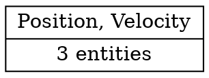

<!-- This file is generated. Do not edit it directly. -->

<a id="rustdoc-item-2583"></a>

# Struct `pill_engine_core::world::World`

```rust
pub struct World;
```

Source: `engine\pill_engine_core\src\world\mod.rs:262`

Holds all entities, archetypes and resources of the ECS.

This is the centre of the engine. It hands out entity ids together with
their generation, owns the archetype storage for every component
combination, tracks the archetype and row each entity lives in, stores
singleton resources, and keeps the component registry that archetype
storage is built from.

## Fields

<a id="rustdoc-item-8840"></a>

### `next_fresh_entity_id`

```rust
next_fresh_entity_id: u64
```

Next fresh entity ID handed out when the free list is empty.

<a id="rustdoc-item-8841"></a>

### `free_entity_ids`

```rust
free_entity_ids: Vec<(u64, u32)>
```

Free list of recycled entity IDs, each with the generation it will be
handed out with. Stored as (id, generation) pairs.

<a id="rustdoc-item-8842"></a>

### `entity_ids`

```rust
entity_ids: std::collections::HashMap<crate::entity::Entity, crate::entity::EntityId>
```

The stable id of every live entity, keyed by its handle.

This is world data, not a component. Keeping it here means the
archetypes do not have to carry a row for it through every migration,
and no query needs the id as component data.

<a id="rustdoc-item-8843"></a>

### `entity_handles`

```rust
entity_handles: std::collections::HashMap<crate::entity::EntityId, crate::entity::Entity>
```

Reverse of [`Self::entity_ids`](#rustdoc-item-8842), so a saved reference finds its entity
in O(1).

<a id="rustdoc-item-8845"></a>

### `entity_id_fallback_counter`

```rust
entity_id_fallback_counter: u64
```

Seeds the counter-derived ids used when the platform has no random
source; see [`Self::mint_entity_id`](#rustdoc-item-8844).

<a id="rustdoc-item-8846"></a>

### `archetypes`

```rust
archetypes: std::collections::HashMap<crate::archetype::ArchetypeId, crate::archetype::Archetype>
```

All archetypes in the world

<a id="rustdoc-item-8847"></a>

### `entity_locations`

```rust
entity_locations: std::collections::HashMap<crate::entity::Entity, EntityLocation>
```

The archetype and row each entity lives in.

<a id="rustdoc-item-8848"></a>

### `storage_factories`

```rust
storage_factories: std::collections::HashMap<crate::component::ComponentId, crate::archetype::StorageFactory>
```

Storage factories for creating component storage by component id

<a id="rustdoc-item-8849"></a>

### `retired_native_storage_ops`

```rust
retired_native_storage_ops: std::collections::HashMap<crate::component::ComponentId, crate::archetype::ColumnOps>
```

The native function table each component id had before its latest
registration replaced it.

A migration that runs in place still holds rows written with the *old*
layout, so it must release them through the code that wrote them. By
the time it runs, `rehome_native_columns` has already written the
arriving generation's table onto every column. `register_component_inner`
saves the outgoing table here, so the migration can restore it for the
removal that drops those rows.

<a id="rustdoc-item-8850"></a>

### `script_updaters`

```rust
script_updaters: std::collections::HashMap<crate::component::ComponentId, fn (_: &mut crate::archetype::ComponentColumns, _: usize, _: crate::entity::Entity, _: *mut World, _: *mut crate::commands::CommandQueue)>
```

Updaters that call `update()` on each script component.

<a id="rustdoc-item-8851"></a>

### `component_registry`

```rust
component_registry: crate::component::ComponentRegistry
```

Component registry for bit indices and names

<a id="rustdoc-item-8852"></a>

### `resources`

```rust
resources: std::collections::HashMap<crate::resource::ResourceId, crate::resource::ErasedResource>
```

The singleton resources, stored by id.

The values are [`ErasedResource`](../resource/struct.ErasedResource.md#rustdoc-item-6438), not `Box<dyn Any>`. A trait object
carries its destructor in a vtable that belongs to the artifact which
created the value. Resources are never cleared on reload, so retiring
the module that owned one would leave that destructor pointing into
unmapped memory. The erased box holds a replaceable function table
instead, the same approach component columns already use.

<a id="rustdoc-item-8853"></a>

### `resource_ticks`

```rust
resource_ticks: std::collections::HashMap<crate::resource::ResourceId, crate::component::ComponentTicks>
```

Change-detection ticks for each resource, keyed the same as `resources`.

<a id="rustdoc-item-8856"></a>

### `resource_factories`

```rust
resource_factories: std::collections::HashMap<crate::resource::ResourceId, crate::resource::ErasedResourceOps>
```

The most recent function table registered for each resource id.

This is the resource equivalent of `storage_factories` for components.
[`Self::rehome_resources`](#rustdoc-item-7350) uses it to update live resources. Both
[`Self::insert_resource`](#rustdoc-item-8854) and [`Self::register_resource`](#rustdoc-item-8855) write it, so a
generation that registers a type again without inserting its value
still leaves a table whose code is mapped.

<a id="rustdoc-item-8857"></a>

### `resource_field_layouts`

```rust
resource_field_layouts: std::collections::HashMap<crate::resource::ResourceId, ComponentFieldLayout>
```

The declared field layout of each foreign resource that sent one.

This is the resource counterpart of `component_field_layouts`. A foreign
resource's bytes mean nothing without its layout, so the editor and any
other reader that wants named fields need it. It is separate from
`resource_factories` because a layout is optional: a resource registered
without one still works, it just cannot be inspected.

<a id="rustdoc-item-8858"></a>

### `shared_resource_claims`

```rust
shared_resource_claims: std::collections::HashMap<crate::resource::ResourceId, SharedResourceClaim>
```

For each shared resource id, the declaration that claimed it and the
layout it declared.

Only shared ids are listed. An ordinary resource is identified by its
`TypeId`, so a second claim on the same id is always the same type. This
is what `ComponentRegistry` records for shared components.

<a id="rustdoc-item-8859"></a>

### `resource_registration_sequence`

```rust
resource_registration_sequence: u64
```

Counter that goes up by one with every resource registration.

<a id="rustdoc-item-8860"></a>

### `resource_registration_stamps`

```rust
resource_registration_stamps: std::collections::HashMap<crate::resource::ResourceId, u64>
```

The most recent registration sequence recorded for each resource id.

The resource counterpart of the component registration log, and needed
for the same reason: `resource_factories` only ever grows, so it cannot
tell a table registered by the current generation from one registered
by a generation that has since retired. There is one entry per id rather
than one per registration, because `insert_resource` replaces a value: a
record per replacement would grow for the life of the process, and every
reload diff would scan and sort it.

<a id="rustdoc-item-8861"></a>

### `resource_claim_counts`

```rust
resource_claim_counts: std::collections::HashMap<crate::resource::ResourceId, u32>
```

How many claimants each resource id currently has.

More than one claimant can register a shared id by name - the project
and a module, for example. `drop_resources` is how one of them retires
what its generation stopped registering. Without this count, the first
claimant to retire the id would destroy a value another one still uses.
Ids with no entry are dropped unconditionally.

<a id="rustdoc-item-8862"></a>

### `change_tick`

```rust
change_tick: u32
```

Counter used for change detection; it only ever goes up.

The [`Engine`](../engine/struct.Engine.md#rustdoc-item-2) adds one to it once per frame. A
parallel batch adds one for each of its members when it reserves their
ticks, and each query that tracks changes adds one when it starts
iterating. The value is a plain `u32` compared with wrapping arithmetic
([`Tick::is_newer_than`](../component/struct.Tick.md#rustdoc-item-2761)), so
wrapping around is harmless.

<a id="rustdoc-item-8863"></a>

### `system_last_run`

```rust
system_last_run: u32
```

The tick at which the system fetching parameters from this world last
ran.

The [`Engine`](../engine/struct.Engine.md#rustdoc-item-2) sets it right before it calls a
system, so change filters built inside the system, such as `Changed<T>`
and `Added<T>`, compare against the right point in time. It starts at
`0`, which means "since the beginning", so an ad-hoc query that no
system drives still sees everything.

<a id="rustdoc-item-8864"></a>

### `archetype_generation`

```rust
archetype_generation: u64
```

Counter that goes up by one whenever an archetype is added or removed.

Queries cache the list of archetypes that match them and compare this
counter on each run: if it has not changed, the cached list is still
correct. It exists only to save that work.

<a id="rustdoc-item-8865"></a>

### `debug_resource_write_locks`

```rust
debug_resource_write_locks: std::sync::Mutex<std::collections::HashSet<crate::resource::ResourceId>>
```

Debug builds only: resources that currently have a mutable borrow.

A scheduler bug that hands `&mut` for one resource to two systems is
caught here. The [`Engine`](../engine/struct.Engine.md#rustdoc-item-2) clears the set at the
start of every frame.

It sits behind a mutex because the systems of one parallel batch each
rebuild `&mut World` from the same pointer and run at the same time.
Their resource ids never overlap, but a `HashSet` is not safe to modify
from several threads whatever its keys are.

The mutex must come from `std`, never from `parking_lot`. The host and
every loaded DLL share this `World`, and each one links its own copy of
`pill_engine` and with it its own `parking_lot`, whose list of parked
threads belongs to that copy alone. An unlock running in another copy's
code would look in its own list and never find the waiting thread. `std`
is a single shared library, and on Windows its mutex waits on the lock's
own address, so a wakeup reaches the waiting thread whichever DLL unlocks
it.

<a id="rustdoc-item-8866"></a>

### `commands_executed_this_frame`

```rust
commands_executed_this_frame: usize
```

How many deferred commands the most recent flush took off the queue.

`CommandQueue::execute_queued_commands` sets it, and the Engine reads it
for its Tracy plots.

<a id="rustdoc-item-8867"></a>

### `iterator_timings`

```rust
iterator_timings: std::sync::Arc<std::sync::Mutex<IteratorTimings>>
```

How long each labelled parallel iterator took, keyed by the string its
`label()` returns.

It is shared through an `Arc` so iterators can read and write it without
a raw `World` pointer. The `Mutex` handles concurrent access from the
systems of one engine batch.

<a id="rustdoc-item-8868"></a>

### `persist_serializers`

```rust
persist_serializers: std::collections::HashMap<crate::component::ComponentId, fn (storage: &crate::archetype::ComponentColumns, index: usize) -> Option<Vec<u8>>>
```

Serializer for each component type, used when taking a snapshot.

<a id="rustdoc-item-8869"></a>

### `persist_deserializers`

```rust
persist_deserializers: std::collections::HashMap<String, fn (bytes: &[u8]) -> Option<Box<dyn Component>>>
```

Deserializer for each type name, used when restoring a snapshot.

<a id="rustdoc-item-8870"></a>

### `persist_inserters`

```rust
persist_inserters: std::collections::HashMap<crate::component::ComponentId, fn (storage: &mut crate::archetype::ComponentColumns, component: Box<dyn Component>)>
```

Inserter for each component type: pushes a `Box<dyn Component>` into
storage.

<a id="rustdoc-item-8871"></a>

### `persist_schema_hashes`

```rust
persist_schema_hashes: std::collections::HashMap<String, u64>
```

Schema hash for each persistable component, keyed by type name.

<a id="rustdoc-item-8872"></a>

### `persist_registration_sequence`

```rust
persist_registration_sequence: u64
```

Counter that goes up by one on every persistable registration, so the
host can list exactly which types one module's `init` registered.

<a id="rustdoc-item-8873"></a>

### `persist_registration_log`

```rust
persist_registration_log: Vec<(String, u64)>
```

Log of persistable registrations in order, as `(type_name, sequence)`
pairs.

<a id="rustdoc-item-8874"></a>

### `superseded_persist_names`

```rust
superseded_persist_names: std::collections::HashSet<String>
```

Type names the host marked as superseded for the init pass about to
run.

A reloaded generation may then replace the persist entries of the
generation before it, instead of being refused as a second claimant.

<a id="rustdoc-item-8875"></a>

### `stale_superseded_persist_names`

```rust
stale_superseded_persist_names: std::collections::HashSet<String>
```

The subset of those names whose earlier generation was already stale,
because it was built against a layout something else has since
replaced.

A registration of one of these in any layout but the registered one is
skipped, so the component is not laid out a second time.

<a id="rustdoc-item-8876"></a>

### `persist_resource_serializers`

```rust
persist_resource_serializers: std::collections::HashMap<crate::resource::ResourceId, crate::persistence::SerializeResourceFn>
```

Serializer for each resource, used when taking a snapshot and keyed by
the live id.

It is keyed by id rather than name because the serializer has to find
the value, and values are stored under their id. The restorer below is
keyed by name instead, because a restore starts from a snapshot entry,
which carries a name and never an id.

<a id="rustdoc-item-8877"></a>

### `persist_resource_restorers`

```rust
persist_resource_restorers: std::collections::HashMap<String, crate::persistence::RestoreResourceFn>
```

Restorer for each name: rebuilds a resource from snapshot bytes.

<a id="rustdoc-item-8878"></a>

### `persist_resource_names`

```rust
persist_resource_names: std::collections::HashMap<crate::resource::ResourceId, String>
```

The persistence name each registered resource id was recorded under.

<a id="rustdoc-item-8879"></a>

### `persist_resource_schema_hashes`

```rust
persist_resource_schema_hashes: std::collections::HashMap<String, u64>
```

Schema hash for each persistable resource, so a reload can tell a
reshaped resource from an unchanged one.

<a id="rustdoc-item-8880"></a>

### `reported_schema_mismatches`

```rust
reported_schema_mismatches: Vec<(crate::component::ComponentId, u64)>
```

Shared-component readers already reported as stale, as `(component,
declared hash)` pairs, so a query that is rebuilt every frame logs its
refusal only once.

<a id="rustdoc-item-8881"></a>

### `component_registration_sequence`

```rust
component_registration_sequence: u64
```

Counter that goes up by one on every component registration, plain or
persistable.

The host uses it to list every type that one module's `init` registered
at all, which shows whether a type was dropped or only downgraded to a
plain component.

<a id="rustdoc-item-8882"></a>

### `component_registration_log`

```rust
component_registration_log: Vec<(String, crate::component::ComponentId, u64)>
```

Log of every component registration, plain and persistable alike, in
order, as `(type_name, component_id, sequence)` triples.

<a id="rustdoc-item-8883"></a>

### `component_field_layouts`

```rust
component_field_layouts: std::collections::HashMap<crate::component::ComponentId, ComponentFieldLayout>
```

The field layout of each component, as its declaring artifact submitted
it or as another language described it.

A `#[derive(PillComponent)]` layout is static and lives in the declaring
artifact. A layout from a manifest is created at runtime and owned by the
world. The C# mirror codegen and the editor's generic inspector read
these layouts. Each reloaded generation records them again, and a
descriptor manifest replaces its entry instead of adding to it.

A native layout is stored with its nested `struct:` fields expanded into
dotted leaf rows (`World::record_component_field_layout`), so a nested
colour or vector can be edited one channel at a time.

<a id="rustdoc-item-8884"></a>

### `asset_field_types`

```rust
asset_field_types: std::collections::HashMap<crate::component::ComponentId, std::collections::HashMap<String, String>>
```

The asset type each `Handle<T>` field of a component refers to, keyed by
field name and holding the registered name of `T`.

The names are owned copies because they come from module code. Each
generation's registration records them again.

<a id="rustdoc-item-8885"></a>

### `value_type_layout_resolver`

```rust
value_type_layout_resolver: Option<crate::component_registry::ValueTypeLayoutResolver>
```

Looks up the layout of a `#[derive(PillMirror)]` value type while another
layout is being recorded, so its nested fields can be expanded.

The facade's `register_all_components` installs it for the length of its
loop and leaves it `None` at all other times. The value types belong to
the DLL that registers them, and a resolver left in place would point
into that DLL after it unloads.

<a id="rustdoc-item-8886"></a>

### `registration_error`

```rust
registration_error: Option<WorldError>
```

The first registration failure of the current init pass, if any.

It is set when the 128-type ceiling is reached, when another registry
error comes out of `register_component`, and when a shared resource claim
or a persistable registration is refused. The registration loop of one
artifact takes it out at the end, so the generated `init` can fail the
whole reload instead of running with only half its components registered.

## Associated functions and methods

<a id="rustdoc-item-1853"></a>

### `load_asset`

```rust
pub fn load_asset<T: ImportedAsset>(self: &mut Self, path: &str) -> Result<Handle<T>, String>;
```

Loads the asset at `path` as `T` and returns its handle.

`path` is below the project's asset directory: `res` in a checkout, the
embedded pack in a shipping build. A file with no `.meta` gets one
holding a new guid when its directory can be written, so the handle can
be saved as a reference later. A path that is already loaded returns its
existing handle and decodes nothing.

#### Errors

Returns the reason when no asset types are registered, when the engine
has no asset manager, when the file cannot be read or decoded as `T`,
and when the path names an asset of another type.

<a id="rustdoc-item-8888"></a>

### `record_component_field_layout`

```rust
pub(crate) fn record_component_field_layout(self: &mut Self, component_id: ComponentId, fields: &'static [ComponentFieldDescriptor]);
```

Records a component's field layout, expanding nested struct fields into
dotted leaf rows for the editor.

A `struct:<path>` field whose type has a known layout - another
component registered with one, or a `#[derive(PillMirror)]` value type -
becomes one row per leaf, named `<field>.<leaf>`, and the row's offset
is composed from the struct's own offset. Only layouts registered
before this call are visible, so a nested component type must be
registered first.

The declared slice is kept beside the flattened view, because a
generated mirror describes declarations, not leaf rows. When nothing
expands, both views borrow the caller's `'static` slice; only a real
expansion builds an owned editor list.

<a id="rustdoc-item-8889"></a>

### `expanded_field_layout`

```rust
pub(in component_field::expand) fn expanded_field_layout(self: &Self, fields: &[ComponentFieldDescriptor]) -> Option<Vec<ComponentFieldDescriptor>>;
```

Expands `struct:` fields into dotted leaf rows where the type's layout
is known. Returns `None` when no field needed expanding.

<a id="rustdoc-item-8890"></a>

### `expand_fields_into`

```rust
pub(in component_field::expand) fn expand_fields_into(self: &Self, fields: &[ComponentFieldDescriptor], prefix: &str, base_offset: usize, inherited_decorators: &[FieldDecorator], expanded_fields: &mut Vec<ComponentFieldDescriptor>, changed: &mut bool);
```

Flattens `fields` into `expanded_fields`, recursing into every
`struct:` field whose type has a known layout.

`prefix` is the dotted path of the struct being flattened (empty at the
top level), `base_offset` is where that struct starts in the component
row, and `inherited_decorators` holds the grouping decorators (`Color`,
`Vector`) declared by the struct fields above. The editor's row model
groups leaves by those decorators, so they must reach the rows the
leaves produce. The recursion ends because a struct cannot contain
itself without a heap indirection, and heap fields are not tagged
`struct:`.

<a id="rustdoc-item-8891"></a>

### `resolve_nested_layout`

```rust
pub(in component_field::expand) fn resolve_nested_layout(self: &Self, path: &str) -> Option<Vec<ComponentFieldDescriptor>>;
```

The field layout a `struct:<path>` tag names, when one is known.

The tag is the path as written on the field, usually an imported short
name (`Color`). A name matching the tag exactly wins; otherwise a name
ending in `::<path>` is taken if it is the only one. The candidates are
the world's registered component layouts and the registering DLL's
`#[derive(PillMirror)]` value types, the latter through the installed
[`ValueTypeLayoutResolver`](../component_registry/type.ValueTypeLayoutResolver.md#rustdoc-item-3500).
An ambiguous suffix resolves to `None`, which leaves the field opaque
and readable; a wrong match would show the wrong rows.

<a id="rustdoc-item-8893"></a>

### `entity_row_location`

```rust
pub(in component_field) fn entity_row_location(self: &Self, entity: Entity) -> Option<(ArchetypeId, usize)>;
```

Returns the archetype and row that hold a live entity, or `None` when
the entity is not alive.

<a id="rustdoc-item-8894"></a>

### `required_component_field_layout`

```rust
pub(in component_field::row) fn required_component_field_layout(self: &Self, component_id: ComponentId, component_name: &str) -> Result<&[ComponentFieldDescriptor], ComponentFieldError>;
```

The registered field layout of a component.

A component with no registered layout, or an empty one, is refused. The
layout is borrowed rather than copied. The field entry points read one
descriptor from it or every descriptor, and the inspector asks for it
once per component row per frame.

<a id="rustdoc-item-3176"></a>

### `resolve_field`

```rust
pub(in component_field::row) fn resolve_field(self: &Self, entity: Entity, component_name: &str, field_name: &str) -> Result<ResolvedField, ComponentFieldError>;
```

Locate one field of one component on one entity.

This is the one place a single field is resolved, so a new single-field
entry point cannot invent its own error path: every miss reports the
same variant with the same payload.

<a id="rustdoc-item-8895"></a>

### `row_column`

```rust
pub(in component_field::row) fn row_column(self: &Self, archetype_id: ArchetypeId, row: usize, component_id: ComponentId, component_name: &str) -> Result<&ComponentColumn, ComponentFieldError>;
```

One component column of one archetype, checked to hold the given row.

`component_name` only feeds the error path: the caller resolved the
component through the entity, so a missing column or a row past its end
is a storage desync and reports the component the caller named.

<a id="rustdoc-item-8896"></a>

### `row_column_mut`

```rust
pub(in component_field::row) fn row_column_mut(self: &mut Self, archetype_id: ArchetypeId, row: usize, component_id: ComponentId, component_name: &str) -> Result<&mut ComponentColumn, ComponentFieldError>;
```

[`Self::row_column`](#rustdoc-item-8895)'s mutable twin, for the write paths.

<a id="rustdoc-item-8897"></a>

### `copy_component_row_bytes`

```rust
pub(in component_field::row) fn copy_component_row_bytes(self: &Self, archetype_id: ArchetypeId, row: usize, component_id: ComponentId, component_name: &str) -> Result<Vec<u8>, ComponentFieldError>;
```

Copy one entity's component row for `component_id` into an owned buffer.

Works for native (Rust) and descriptor (foreign-language) columns alike.
The caller owns the returned bytes, so no borrow outlives this call.

<a id="rustdoc-item-8900"></a>

### `read_component_field`

```rust
pub fn read_component_field(self: &Self, entity: Entity, component_name: &str, field_name: &str) -> Result<FieldValue, ComponentFieldError>;
```

The value of one field of one component on one entity.

The component is resolved through the entity's own archetype (see
[`Self::resolve_entity_component_id`](#rustdoc-item-8899)), so the returned value always
describes data the entity really holds. A read never mutates and never
stamps a change tick.

#### Errors

[`ComponentFieldError::EntityNotFound`](../component_field/enum.ComponentFieldError.md#rustdoc-item-3339) when the entity is not alive,
[`ComponentFieldError::ComponentNotFound`](../component_field/enum.ComponentFieldError.md#rustdoc-item-3341) when it does not carry that
component, [`ComponentFieldError::ComponentHasNoFieldLayout`](../component_field/enum.ComponentFieldError.md#rustdoc-item-3345) when the
component has no field layout or an empty one, and
[`ComponentFieldError::FieldNotFound`](../component_field/enum.ComponentFieldError.md#rustdoc-item-3348) when the layout does not name
that field. After those checks pass, a missing archetype reports
[`ComponentFieldError::EntityNotFound`](../component_field/enum.ComponentFieldError.md#rustdoc-item-3339) again and a missing column or
row reports [`ComponentFieldError::ComponentStorageMissing`](../component_field/enum.ComponentFieldError.md#rustdoc-item-3343); both mean
that the storage no longer matches the world's own bookkeeping.

<a id="rustdoc-item-8901"></a>

### `read_component_fields`

```rust
pub fn read_component_fields(self: &Self, entity: Entity, component_name: &str) -> Result<Vec<FieldValue>, ComponentFieldError>;
```

Every field of one component, in layout order.

Cheaper than calling [`Self::read_component_field`](#rustdoc-item-8900) once per field: the
row is located and copied once. The inspector reads a whole component
this way, and so does a scene save.

#### Errors

[`ComponentFieldError::EntityNotFound`](../component_field/enum.ComponentFieldError.md#rustdoc-item-3339) when the entity is not alive,
[`ComponentFieldError::ComponentNotFound`](../component_field/enum.ComponentFieldError.md#rustdoc-item-3341) when it does not carry that
component, and [`ComponentFieldError::ComponentHasNoFieldLayout`](../component_field/enum.ComponentFieldError.md#rustdoc-item-3345) when
the component has no field layout or an empty one. After those checks
pass, a missing archetype reports [`ComponentFieldError::EntityNotFound`](../component_field/enum.ComponentFieldError.md#rustdoc-item-3339)
again and a missing column or row reports
[`ComponentFieldError::ComponentStorageMissing`](../component_field/enum.ComponentFieldError.md#rustdoc-item-3343).

<a id="rustdoc-item-8902"></a>

### `with_asset_type`

```rust
pub(in component_field::row) fn with_asset_type(self: &Self, component_id: ComponentId, descriptor: &ComponentFieldDescriptor, value: FieldValue) -> FieldValue;
```

Adds the field's recorded asset type to an asset value that carries
none, and returns every other value unchanged. A field with no recorded
type leaves the value as it was.

<a id="rustdoc-item-8903"></a>

### `record_asset_field_type`

```rust
pub fn record_asset_field_type(self: &mut Self, component: ComponentId, field: &str, asset_type: &str);
```

Record that `component`'s handle field `field` references assets of the
type registered as `asset_type`.

Called by `#[derive(PillComponent)]`'s generated registration for each
`Handle<T>` field, with the asset's shared name (or its Rust type name
when it has no shared name), and by a foreign-language backend for its
components.

The name is copied: the caller's string may live in a module that a
reload unmaps.

<a id="rustdoc-item-8904"></a>

### `check_asset_type`

```rust
pub(in component_field::row) fn check_asset_type(self: &Self, component_id: ComponentId, field_name: &str, value: &FieldValue) -> Result<(), ComponentFieldError>;
```

Refuses an asset value whose type differs from the one recorded for the
field. A value with no type, or a field with no recorded type, passes.

<a id="rustdoc-item-8905"></a>

### `asset_field_type`

```rust
pub fn asset_field_type(self: &Self, component: ComponentId, field: &str) -> Option<&str>;
```

The asset type `component`'s handle field `field` references, if
recorded.

<a id="rustdoc-item-8908"></a>

### `write_component_field`

```rust
pub fn write_component_field(self: &mut Self, entity: Entity, component_name: &str, field_name: &str, value: FieldValue) -> Result<(), ComponentFieldError>;
```

Writes one field of a live component.

The component is resolved through the entity's own archetype, and the
value is checked against the registered field layout before anything is
written. The write goes through the component's column and stamps that
row's `ComponentTicks::changed`, so `Changed<T>` systems observe the
edit on their next run; [`Self::get_component_mut`](#rustdoc-item-8907) hands out the same
column slot without that stamp. Nothing is written when any validation
fails.

#### Errors

Fails before writing anything when the field cannot be resolved, with
the variants [`Self::read_component_field`](#rustdoc-item-8900) reports, or when the value
is refused: [`ComponentFieldError::AssetTypeMismatch`](../component_field/enum.ComponentFieldError.md#rustdoc-item-3362) for an asset
value of another type, [`ComponentFieldError::UnsupportedField`](../component_field/enum.ComponentFieldError.md#rustdoc-item-3159) for a
heap-backed field, a tag outside the editable vocabulary or a fixed
array of non-scalars, [`ComponentFieldError::TypeMismatch`](../component_field/enum.ComponentFieldError.md#rustdoc-item-3160) when the
value does not match the field's tag, and
[`ComponentFieldError::ArrayLengthMismatch`](../component_field/enum.ComponentFieldError.md#rustdoc-item-3161) when a whole array has the
wrong element count. A payload that would extend past the row reports
[`ComponentFieldError::UnsupportedField`](../component_field/enum.ComponentFieldError.md#rustdoc-item-3159), and a column or row that has
gone missing reports [`ComponentFieldError::ComponentStorageMissing`](../component_field/enum.ComponentFieldError.md#rustdoc-item-3343).

<a id="rustdoc-item-3256"></a>

### `build_component_image`

```rust
pub fn build_component_image(self: &Self, component_name: &str, fields: &[(String, FieldValue)]) -> Result<Vec<u8>, ComponentFieldError>;
```

Builds a zero-initialised component image for a registered type name,
then writes the supplied field values over it.

Used where the entity does not exist yet: the editor creating an entity
or adding a component from field values without knowing the concrete
Rust type, and a scene load attaching a component the document lists.
With no entity to look through, the component is resolved through the
registry, which is the correct resolver for this path.

Zero-initialisation is only valid for a component with a non-empty
registered field layout, and a missing or empty layout is refused:
without a layout the image cannot be described field by field.

#### Errors

[`ComponentFieldError::ComponentNotFound`](../component_field/enum.ComponentFieldError.md#rustdoc-item-3341) when no component is
registered under that name, or when two registrations claim it;
[`ComponentFieldError::ComponentHasNoFieldLayout`](../component_field/enum.ComponentFieldError.md#rustdoc-item-3345) when it has no field
layout, an empty one, or no registered size; and
[`ComponentFieldError::FieldNotFound`](../component_field/enum.ComponentFieldError.md#rustdoc-item-3348) when a supplied field name is
not in the layout. A value is refused the way a field write refuses it:
[`ComponentFieldError::AssetTypeMismatch`](../component_field/enum.ComponentFieldError.md#rustdoc-item-3362),
[`ComponentFieldError::TypeMismatch`](../component_field/enum.ComponentFieldError.md#rustdoc-item-3160),
[`ComponentFieldError::ArrayLengthMismatch`](../component_field/enum.ComponentFieldError.md#rustdoc-item-3161) or
[`ComponentFieldError::UnsupportedField`](../component_field/enum.ComponentFieldError.md#rustdoc-item-3159), the last also for a value
that would extend past the image.

<a id="rustdoc-item-8909"></a>

### `write_component_array_element`

```rust
pub fn write_component_array_element(self: &mut Self, entity: Entity, component_name: &str, field_name: &str, index: usize, value: FieldValue) -> Result<(), ComponentFieldError>;
```

Writes one element of a fixed-size array field.

#### Errors

Fails before writing anything when the field cannot be resolved, with
the variants [`Self::read_component_field`](#rustdoc-item-8900) reports, when the field is
not a fixed array of scalars ([`ComponentFieldError::TypeMismatch`](../component_field/enum.ComponentFieldError.md#rustdoc-item-3160) for
another tag, [`ComponentFieldError::UnsupportedField`](../component_field/enum.ComponentFieldError.md#rustdoc-item-3159) for non-scalar
elements or an unknown element size), when `index` is past the array
([`ComponentFieldError::ArrayIndexOutOfRange`](../component_field/enum.ComponentFieldError.md#rustdoc-item-3358)), or when the value does
not encode into one element ([`ComponentFieldError::TypeMismatch`](../component_field/enum.ComponentFieldError.md#rustdoc-item-3160)). A
column or row that has gone missing reports
[`ComponentFieldError::ComponentStorageMissing`](../component_field/enum.ComponentFieldError.md#rustdoc-item-3343).

<a id="rustdoc-item-8910"></a>

### `apply_row_write`

```rust
pub(in component_field) fn apply_row_write(self: &mut Self, target: RowWriteTarget<'_>, row_offset: usize, bytes: &[u8]) -> Result<(), ComponentFieldError>;
```

Writes `bytes.len()` bytes at `row_offset` of one component row.

`target.component_name` only feeds the error paths: the caller resolved
the component through the entity, so a missing column or row here is a
storage desync and reports the component the caller named.

<a id="rustdoc-item-8911"></a>

### `stamp_row_changed`

```rust
pub(in component_field::row) fn stamp_row_changed(self: &mut Self, archetype_id: ArchetypeId, row: usize, component_id: ComponentId, component_name: &str, tick: Tick) -> Result<(), ComponentFieldError>;
```

Stamps one row's `changed` tick so `Changed<T>` systems react to the
write.

<a id="rustdoc-item-8914"></a>

### `register_persistable_component`

```rust
pub fn register_persistable_component<T>(self: &mut Self) where T: Component + Serialize + DeserializeOwned + Default + 'static;
```

Register a component type that supports persistence and schema migration.

Besides the normal component registration (bit index, storage factory),
this stores the type's serialize, deserialize and insert functions, so
the engine can migrate the type's rows during a hot reload.

`T` must implement `serde::Serialize + serde::DeserializeOwned` so JSON
can round-trip its data. When the struct shape changes between reloads,
serde matches fields by **name**: a new field gets the value from
`Default::default()`, and a removed field is silently ignored.

This registration's schema hash covers the type name, the type's size
and the kind of every field in a default instance. A type registered
through the derive uses
[`Self::register_persistable_component_with_layout`](#rustdoc-item-8913) instead, whose hash
also covers the declared field layout. Two shapes that serialize
identical defaults but hold different containers (`Vec<f32>` against
`Vec<String>`) can therefore never compare equal.

<a id="rustdoc-item-8915"></a>

### `register_persistable_component_inner`

```rust
pub(in persistence) fn register_persistable_component_inner<T>(self: &mut Self, fields: &'static [crate::component_registry::ComponentFieldDescriptor]) where T: Component + Serialize + DeserializeOwned + Default + 'static;
```

Shared body of the two registration entry points.

`fields` is the compile-time field layout when the caller has one, and
the schema hash includes it, so a changed container kind or element
type forces a migration instead of taking the unchanged-schema fast
path. This does not record the layout for the editor; the
layout-carrying entry point does that after the call.

<a id="rustdoc-item-8917"></a>

### `supersede_persist_registrations`

```rust
pub fn supersede_persist_registrations(self: &mut Self, type_names: &[String]);
```

Announce the persistable type names a retiring generation registered, so
the init pass that follows may replace their persist entries instead of
being refused as a concurrent peer.

A reloaded project registers every type its previous `init` registered
again, and the rebuilt image gives each of them a fresh `TypeId` under
the same name. At the registration site that looks exactly like another
binary that linked the same type. Only the host can tell the two apart,
because it captured these names from the generation it is retiring, so
it announces them here, just before init.

An announcement covers one init pass. Each mark is used up by the
registration it applies to, and
[`Self::clear_superseded_persist_registrations`](#rustdoc-item-8916) drops the rest: a name
the new generation no longer declares was forgotten, not superseded, and
must not let a later peer through.

<a id="rustdoc-item-8918"></a>

### `mark_stale_superseded_persist_registrations`

```rust
pub fn mark_stale_superseded_persist_registrations(self: &mut Self, type_names: &[String]);
```

Announce which superseded names the retiring generation was already
stale for, because it was built against a layout of a shared component
that another subject's reload has replaced since.

Only a subject that was current for a component may re-lay it out. A
stale one registering the old layout again - the rollback of a module
whose rebuild failed - would otherwise take the component back to a
layout every current subject has left. That registration is skipped, and
the registered layout is kept.

<a id="rustdoc-item-8916"></a>

### `clear_superseded_persist_registrations`

```rust
pub fn clear_superseded_persist_registrations(self: &mut Self);
```

Drop the marks left by [`Self::supersede_persist_registrations`](#rustdoc-item-8917) and
[`Self::mark_stale_superseded_persist_registrations`](#rustdoc-item-8918).

<a id="rustdoc-item-8913"></a>

### `register_persistable_component_with_layout`

```rust
pub fn register_persistable_component_with_layout<T>(self: &mut Self, fields: &'static [crate::component_registry::ComponentFieldDescriptor]) where T: Component + Serialize + DeserializeOwned + Default + 'static;
```

Register a persistable component together with its compile-time field
layout, so the C# mirror codegen can emit a typed struct and the schema
hash can account for container fields. See
[`Self::register_component_with_layout`](#rustdoc-item-3407).

The layout separates two shapes whose defaults look identical to serde:
`Vec<f32>` and `Vec<String>` both serialize a default instance as `[]`,
but their type tags differ, so changing the element type changes the
hash. The reload then migrates the stored values instead of reading the
old buffer as the new layout.

<a id="rustdoc-item-6319"></a>

### `migrate_changed_persistable_components`

```rust
pub fn migrate_changed_persistable_components(self: &mut Self, previous_metadata_by_name: &HashMap<String, PersistTypeMetadata>, changed_type_names: &HashSet<String>, pre_swap_entities: Option<&HashSet<Entity>>) -> SelectiveMigrationReport;
```

Migrates only the persistable component types a reload changed.

For each changed type name it reads the old value with the serializer
captured before the reload, then writes it back through the
deserializer and inserter the new `init` registered. Only the affected
component columns are rewritten.

`pre_swap_entities` holds the entities that existed before the incoming
generation's `init` ran (see [`Self::capture_live_entities`](#rustdoc-item-8920)). Entities
outside that set were spawned by the new generation and already hold
current-layout values, so a column rebuild reads their rows with the
current serializer instead of the retiring one. Pass `None` when the
arriving generation spawned no entity during `init`, so every entity
predates the migration.

<a id="rustdoc-item-8921"></a>

### `migrate_single_component_type`

```rust
pub(in persistence) fn migrate_single_component_type(self: &mut Self, type_name: &str, previous_metadata: &PersistTypeMetadata, pre_swap_entities: Option<&HashSet<Entity>>) -> Result<usize, PersistenceError>;
```

Migrates one persistable component type from its previous registration
to the current one.

Picks an in-place column swap when the [`ComponentId`](../component/enum.ComponentId.md#rustdoc-item-83) is unchanged, or
a full archetype move when a reload gave the type a new id.

#### Errors

Returns [`PersistenceError::ComponentTypeUnregistered`](../error/enum.PersistenceError.md#rustdoc-item-4811) when the type
name no longer resolves to a registered component,
[`PersistenceError::ComponentTypeAmbiguous`](../error/enum.PersistenceError.md#rustdoc-item-4814) when the name matches more
than one component, [`PersistenceError::DeserializerMissing`](../error/enum.PersistenceError.md#rustdoc-item-4816) when no
deserializer is registered for the type name,
[`PersistenceError::InserterMissing`](../error/enum.PersistenceError.md#rustdoc-item-4820) when no inserter is registered
for the resolved component id, and [`PersistenceError::SerializerMissing`](../error/enum.PersistenceError.md#rustdoc-item-4818)
when the id is unchanged but no serializer is registered for it. Errors
from the in-place or cross-archetype migration below propagate as they
are.

<a id="rustdoc-item-8922"></a>

### `migrate_component_column_in_place`

```rust
pub(in persistence) fn migrate_component_column_in_place(self: &mut Self, component_id: ComponentId, serialize_retiring_component: fn (storage: &crate::archetype::ComponentColumns, index: usize) -> Option<Vec<u8>>, serialize_current_component: fn (storage: &crate::archetype::ComponentColumns, index: usize) -> Option<Vec<u8>>, deserialize_current_component: fn (bytes: &[u8]) -> Option<Box<dyn Component>>, insert_current_component: fn (storage: &mut crate::archetype::ComponentColumns, component: Box<dyn Component>), pre_swap_entities: Option<&HashSet<Entity>>) -> Result<usize, PersistenceError>;
```

Rewrites one component column in place in every archetype that holds the
old component id.

For each such archetype it serializes the old values, decodes them with
the new schema (an empty `{}` is tried when the bytes no longer parse),
removes the old storage column, builds a new one from the registered
storage factory, and inserts the migrated values.

`serialize_current_component` reads the rows the incoming generation
spawned during `init`. Those rows already hold current-layout values,
and the retiring serializer would read their bytes as the old shape.

#### Errors

Returns [`PersistenceError::SerializationFailed`](../error/enum.PersistenceError.md#rustdoc-item-4824) when the serializer of
the generation that wrote a value refuses it, and
[`PersistenceError::DeserializationFailed`](../error/enum.PersistenceError.md#rustdoc-item-4822) when a value cannot be
decoded from either its own bytes or `{}`.

Also returns [`PersistenceError::StorageRemovalFailed`](../error/enum.PersistenceError.md#rustdoc-item-4826) when the old
storage column cannot be removed,
[`PersistenceError::StorageFactoryMissing`](../error/enum.PersistenceError.md#rustdoc-item-4828) when no storage factory is
registered, and [`PersistenceError::NativeStorageExpected`](../error/enum.PersistenceError.md#rustdoc-item-4830) when the
component id is not native storage or its registered factory is not a
native factory.

#### Panics

Panics when the registered native layout cannot describe an allocation.
The layout comes from a Rust type at registration time, so this can only
happen if the registration itself is broken.

<a id="rustdoc-item-8923"></a>

### `migrate_component_across_archetypes`

```rust
pub(in persistence) fn migrate_component_across_archetypes(self: &mut Self, retiring_component_id: ComponentId, current_component_id: ComponentId, serialize_retiring_component: fn (storage: &crate::archetype::ComponentColumns, index: usize) -> Option<Vec<u8>>, deserialize_current_component: fn (bytes: &[u8]) -> Option<Box<dyn Component>>, insert_current_component: fn (storage: &mut crate::archetype::ComponentColumns, component: Box<dyn Component>)) -> Result<usize, PersistenceError>;
```

Moves every entity from the archetypes that hold the old component id
into archetypes that hold the new one.

For each entity it serializes the old component value and decodes it
with the new schema (an empty `{}` is tried when the bytes no longer
parse), moves the unchanged components across byte for byte, and inserts
the migrated value. A reload uses this path when it gives a type a new
[`ComponentId`](../component/enum.ComponentId.md#rustdoc-item-83).

#### Errors

Returns [`PersistenceError::SerializationFailed`](../error/enum.PersistenceError.md#rustdoc-item-4824) when the retiring
generation's serializer refuses a value; the source archetype is put
back before that error is returned.

Returns [`PersistenceError::DeserializationFailed`](../error/enum.PersistenceError.md#rustdoc-item-4822) when a migrated value
cannot be decoded from either its stored bytes or `{}`,
[`PersistenceError::DestinationArchetypeMissing`](../error/enum.PersistenceError.md#rustdoc-item-4833) when the destination
archetype cannot be created, and [`PersistenceError::ColumnMoveFailed`](../error/enum.PersistenceError.md#rustdoc-item-4832)
when an unchanged column cannot hand its row to the destination.

<a id="rustdoc-item-8926"></a>

### `resolve_component_id_by_name`

```rust
pub(in persistence) fn resolve_component_id_by_name(self: &Self, type_name: &str) -> Result<Option<ComponentId>, WorldError>;
```

Returns the single [`ComponentId`](../component/enum.ComponentId.md#rustdoc-item-83) that a persistable component type
name resolves to.

After several hot reloads the component registry can hold one entry per
reload for the same type name, each with a different `TypeId`.
Registering a new generation removes every same-name entry from
`persist_inserters` (see [`Self::register_persistable_component`](#rustdoc-item-8914)), so
the filter below normally leaves exactly one candidate.

The bit index is deliberately not used to break a tie, because it does
not order registrations in time: `ComponentRegistry::allocate_bit`
hands out bits reclaimed by `remove` before it advances `next_bit`, so
a later registration can receive a lower bit than an earlier one. More
than one surviving candidate therefore means eviction did not do its
job, which is a bug rather than something to break a tie on.

[`persist_registration_sequence`](Self::persist_registration_sequence)
is the real chronological ordering, should one ever be needed.

#### Errors

Returns [`WorldError::ComponentNameAmbiguous`](../error/enum.WorldError.md#rustdoc-item-4563) when more than one
registration survives for the name.

<a id="rustdoc-item-8927"></a>

### `resolve_component_id_by_name_logged`

```rust
pub(in persistence) fn resolve_component_id_by_name_logged(self: &Self, type_name: &str) -> Option<ComponentId>;
```

[`Self::resolve_component_id_by_name`](#rustdoc-item-8926) for callers that cannot return
an error, treating an ambiguous name as unresolved.

The manifest builder is the only caller: it leaves an unresolved type
out of the manifest. Reporting the ambiguity and taking that path is
better than a tiebreak that silently picks one candidate and binds rows
to the wrong column.

<a id="rustdoc-item-8928"></a>

### `persist_schema_hash`

```rust
pub fn persist_schema_hash(self: &Self, type_name: &str) -> Option<u64>;
```

Returns the schema hash currently recorded for one persistable
component name.

The host stores the hash each subject registered and compares it with
this one later. If another subject's reload replaced the type's layout
in between, the comparison identifies the binaries still built against
the old layout, without asking them anything.

<a id="rustdoc-item-6255"></a>

### `persist_type_manifest`

```rust
pub fn persist_type_manifest(self: &Self) -> Vec<PersistTypeManifestEntry>;
```

Returns one entry per persistable component that still resolves to a
registered id, sorted by type name.

A type whose name resolves to no id, or to more than one, is left out
of the manifest.

<a id="rustdoc-item-8925"></a>

### `persist_registration_sequence`

```rust
pub fn persist_registration_sequence(self: &Self) -> u64;
```

Returns the counter that a module's persistable registrations are
recorded against.

The host reads it before a module's `init`, so afterwards it can list
exactly the persistable types that `init` registered.

<a id="rustdoc-item-8929"></a>

### `persist_type_names_registered_since`

```rust
pub fn persist_type_names_registered_since(self: &Self, sequence: u64) -> Vec<String>;
```

Returns the persistable component names registered at or after
`sequence`.

The host compares this list with the one the previous generation
registered, so a component type that was accidentally dropped from the
module is reported instead of silently orphaned.

The test is `>=`, not `>`: a registration stores the current counter
value and then adds one, so a type registered right after the capture
carries exactly the captured value.

<a id="rustdoc-item-8930"></a>

### `component_registration_sequence`

```rust
pub fn component_registration_sequence(self: &Self) -> u64;
```

Returns the counter that every component registration is recorded
against, plain or persistable.

The host reads it before a module's `init`, so afterwards it can list
exactly the component types that `init` registered.

<a id="rustdoc-item-8931"></a>

### `registered_component_names_since`

```rust
pub fn registered_component_names_since(self: &Self, sequence: u64) -> Vec<String>;
```

Returns the names of all component types registered at or after
`sequence`, plain and persistable alike.

Unlike [`Self::persist_type_names_registered_since`](#rustdoc-item-8929), this covers plain
components too. That lets the host tell a type a reloaded module
dropped entirely apart from one that was only downgraded from
persistable to plain, whose data is still live.

<a id="rustdoc-item-8932"></a>

### `registered_component_ids_since`

```rust
pub fn registered_component_ids_since(self: &Self, sequence: u64) -> Vec<ComponentId>;
```

Returns the ids of all component types registered at or after
`sequence`.

The id-level twin of [`Self::registered_component_names_since`](#rustdoc-item-8931). A
rebuilt image gives every name it declares a fresh `TypeId`, so only
the id tells a failed generation's entries apart from a rollback
generation's re-registration of the same names.

<a id="rustdoc-item-8933"></a>

### `drop_forgotten_components`

```rust
pub fn drop_forgotten_components(self: &mut Self, type_names: &[String]) -> usize;
```

Removes the component from every entity for each type that no module
or project generation registers any more, then forgets the type.
Returns the number of entities whose data was removed.

The host calls this after a reloaded module or project stopped
registering a persistable type entirely, so the type is not even a
plain component and its data is truly orphaned. Removing the rows now,
while the generation that last registered the type is still loaded,
means the drop never calls into an unloaded DLL.

Every native id sharing the name loses its rows, not only the one a
name resolver would return. An ambiguous name resolves to nothing, and
a superseded generation's rows would otherwise survive the registration
purge that `forget_component_type` runs for all of them.

<a id="rustdoc-item-8935"></a>

### `retire_component_storage`

```rust
pub fn retire_component_storage(self: &mut Self, component_ids: &[ComponentId]) -> usize;
```

Removes the given components from every entity that carries them and
retires their registrations. Returns how many entities lost data.

This sweep works by id, for the host to use when a failed generation's
registrations have to go: the ids are the only handle that tells those
registrations apart from a rollback generation's re-registration of the
same names. For each id, every entity carrying it loses that one
component, so rows the failed generation created do not leak into the
image that is about to be retired. The registration is then retired
through [`Self::retire_registration`](#rustdoc-item-8934), and the name-keyed entries
(deserializer and schema hash) are dropped only when no surviving
registration still claims the name.

Unlike the name-based [`Self::drop_forgotten_components`](#rustdoc-item-8933), this covers
managed components: one has no Rust type to name it by, so the host
reaches it through the id its binding held. The host also uses this
when a reloaded manifest stops naming a managed component.

<a id="rustdoc-item-8934"></a>

### `retire_registration`

```rust
pub(crate) fn retire_registration(self: &mut Self, component_id: ComponentId);
```

Retires one registration, releasing its bit only when no archetype that
still holds rows maps that bit.

An archetype's mask is also its id, so a bit that returned to the pool
while an archetype still referenced it would make two component sets
share one id. The next registration that reused the bit would then
reach the stale archetype through `get_or_create_archetype` and be served
its columns. Every caller removes the entities holding the type first,
so the archetypes carrying the bit are empty and are dropped here. If
one still holds rows, the registration is removed without releasing the
bit, because a leaked bit is recoverable while a shared archetype is
not.

<a id="rustdoc-item-8936"></a>

### `forget_component_type`

```rust
pub(in persistence) fn forget_component_type(self: &mut Self, type_name: &str);
```

Removes every registration and name-keyed persist entry of one
forgotten component type, so the type stops appearing in the manifest
and in the registry.

<a id="rustdoc-item-8937"></a>

### `capture_persist_type_metadata`

```rust
pub fn capture_persist_type_metadata(self: &Self) -> HashMap<String, PersistTypeMetadata>;
```

Returns the serializer and schema hash of every persistable component
currently registered, keyed by type name.

The host captures this before a reload replaces the registrations.
Migration then reads the retiring generation's rows through these
serializers, the only code that understands the old layout.

<a id="rustdoc-item-8920"></a>

### `capture_live_entities`

```rust
pub fn capture_live_entities(self: &Self) -> HashSet<Entity>;
```

Returns the id of every entity that is currently alive.

Migration runs after the incoming generation's `init`, so archetypes
may already hold entities that `init` spawned, written with the current
schema. This set lets the migration tell those entities apart from the
ones that need converting. See
[`Self::migrate_changed_persistable_components`](#rustdoc-item-6319).

<a id="rustdoc-item-8940"></a>

### `register_persistable_resource`

```rust
pub fn register_persistable_resource<T>(self: &mut Self) where T: Resource + Serialize + DeserializeOwned + Default;
```

Register a resource that survives snapshot, restore and reload.

This is the resource counterpart of
[`Self::register_persistable_component`](#rustdoc-item-8914). It is a registration call
rather than a derive attribute because resources have no derive: a
resource is declared with `impl Resource` and registered by hand, so
turning persistence on is one more call at the same place.

Registering is what opts a resource in. A resource registered with
[`Self::register_resource`](#rustdoc-item-8855) alone never appears in a snapshot, just as a
component registered with [`Self::register_component`](#rustdoc-item-8939) alone never does.

`T` must implement `Serialize + DeserializeOwned + Default`, for the same
reason a persistable component must: the value crosses between two shapes
of the type as JSON, and `Default` supplies the fields a snapshot written
before those fields existed cannot carry.

<a id="rustdoc-item-8942"></a>

### `register_persistable_resource_as`

```rust
pub fn register_persistable_resource_as<T>(self: &mut Self, type_name: &str) where T: Resource + Serialize + DeserializeOwned + Default;
```

Register a persistable resource under a persistence name you choose.

The name is the only thing a snapshot and a reload match on, so pinning
it separates save compatibility from the Rust path: moving a resource to
another module, or renaming the crate it lives in, then costs nothing.
The foreign registration takes a name for the same reason: a resource
declared by another language has no Rust type path to record.

Two different Rust types may share one persistence name. That is the
reload case, not a mistake: the arriving build of a type is a different
type as far as this process is concerned. The later registration replaces
the earlier one's entries, and the value the earlier one owns is carried
across by [`Self::migrate_changed_persistable_resources`](#rustdoc-item-8941).

<a id="rustdoc-item-8943"></a>

### `register_persistable_foreign_resource`

```rust
pub fn register_persistable_foreign_resource(self: &mut Self, type_name: &str) -> bool;
```

Record the persistence name of a resource declared by another language.

A foreign resource has no Rust type, so no serializer can be generated
for it. It needs none: its payload is plain bytes and the world already
knows their size, so the bytes are the value. Recording the name is all
it takes to make the resource visible to a snapshot, which is why this
takes a name instead of a type parameter.

Returns whether the name belongs to a registered foreign resource. A
caller that has just registered one can ignore the result.

<a id="rustdoc-item-8944"></a>

### `is_resource_persistable`

```rust
pub fn is_resource_persistable<T: Resource>(self: &Self) -> bool;
```

Whether the resource `T` is registered for persistence.

<a id="rustdoc-item-8945"></a>

### `snapshot_resources`

```rust
pub fn snapshot_resources(self: &Self) -> ResourceSnapshot;
```

Capture the value of every persistable resource.

A resource with no value stored yet is absent rather than written as
null: a snapshot records what the world held, and "never inserted" is
not a value. Restoring such a snapshot leaves the resource as whatever
the loading generation inserts for it.

<a id="rustdoc-item-8946"></a>

### `restore_resources`

```rust
pub fn restore_resources(self: &mut Self, snapshot: &ResourceSnapshot);
```

Restore resource values captured by [`Self::snapshot_resources`](#rustdoc-item-8945).

A resource the loading generation does not declare is skipped, just as a
component type the project stopped declaring is skipped: a snapshot
records what was there, it does not ask for it to be recreated.

<a id="rustdoc-item-8947"></a>

### `restore_foreign_resource`

```rust
pub(in persistence) fn restore_foreign_resource(self: &mut Self, type_name: &str, payload: &[u8]) -> bool;
```

Write a foreign resource's bytes back, when this generation declares it.

Returns whether the payload was accepted. A payload whose size disagrees
with the current declaration is refused, not padded: foreign bytes carry
no field names, so a shorter or longer payload cannot be fitted to the
live layout without a migration, and only the declaring language can
describe one.

<a id="rustdoc-item-6404"></a>

### `persist_resource_manifest`

```rust
pub fn persist_resource_manifest(self: &Self) -> Vec<PersistResourceManifestEntry>;
```

The persistable Rust resources this generation declares.

There is one entry per resource with a registered serializer and schema
hash, so a persistable foreign resource, which has neither, is absent.
The reload captures this before the new generation registers its types,
and the pass afterwards compares the hashes and migrates only the
resources whose shape changed. The component twin is
[`Self::persist_type_manifest`](#rustdoc-item-6255).

<a id="rustdoc-item-8941"></a>

### `migrate_changed_persistable_resources`

```rust
pub fn migrate_changed_persistable_resources(self: &mut Self, previous_manifest: &[PersistResourceManifestEntry]) -> Vec<String>;
```

Migrate every persistable resource whose schema changed across a reload.

**Call this while the retiring generation's image is still mapped.** Each
serializer in `previous_manifest` was generated for the old shape and
lives in the outgoing DLL, and it is the only code that can read the
stored value correctly. That is why the manifest is captured before the
swap, and why this runs before the old image is released.

A value is read through the old serializer, carried across as JSON, and
written back through the arriving type's restorer, which merges it over
the new `Default`. A field added since the previous build therefore
arrives defaulted and a removed field is dropped, exactly as in the
component migration. A resource whose hash is unchanged is left alone,
keeping its allocation and its change ticks.

Returns the names that were migrated, sorted.

<a id="rustdoc-item-8949"></a>

### `settings_asset_manager_ids`

```rust
pub fn settings_asset_manager_ids(self: &Self) -> Vec<ResourceId>;
```

The managers whose settings live in a settings asset, sorted by id.

Only registered *and* live managers are listed: a type that declared its
surface but inserted no value has nothing to configure.

<a id="rustdoc-item-8950"></a>

### `manager_settings_surface`

```rust
pub fn manager_settings_surface(self: &Self, manager: ResourceId) -> Option<ManagerSettingsSurface>;
```

What the manager's settings asset declares, or `None` when the type is
not a settings-asset manager.

<a id="rustdoc-item-8951"></a>

### `manager_settings_path`

```rust
pub fn manager_settings_path(self: &Self, manager: ResourceId) -> Option<String>;
```

The path the manager's settings asset reads: the bound path when the
manager was bound, and the conventional one otherwise.

Returns `None` when the type is not a settings-asset manager.

<a id="rustdoc-item-8440"></a>

### `bind_manager_settings`

```rust
pub fn bind_manager_settings<impl Into<String>: Into<String>>(self: &mut Self, manager: ResourceId, path: impl Into<String>) -> Option<Result<SettingsOutcome, String>>;
```

Binds the manager to a settings asset and applies it now.

The binding is recorded even when the file cannot be applied, so a later
[`Self::refresh_manager_settings`](#rustdoc-item-8952) retries the same file instead of
falling back to the conventional path.

Returns `None` when the type is not a settings-asset manager, the
manager's outcome otherwise: a refusal is the manager's own call, while
`Err` carries the reason the file itself could not be used.

<a id="rustdoc-item-8397"></a>

### `missing_manager_settings`

```rust
pub fn missing_manager_settings(self: &mut Self) -> Vec<MissingManagerSettings>;
```

The managers whose settings file does not exist yet, each with the bytes
that create it from the document defaults.

Writing them is the host's job: it knows the project's `res` directory,
and this module deliberately owns no filesystem root. The conventional
path is bound as the file is reported, so
[`Self::apply_manager_settings_asset`](#rustdoc-item-8953) finds the file once it is written.

<a id="rustdoc-item-8953"></a>

### `apply_manager_settings_asset`

```rust
pub fn apply_manager_settings_asset(self: &mut Self, manager: ResourceId) -> Option<Result<SettingsOutcome, String>>;
```

Applies the manager's settings asset to its live value.

Returns `None` when the type is not a settings-asset manager, the
manager's outcome otherwise.

<a id="rustdoc-item-8952"></a>

### `refresh_manager_settings`

```rust
pub fn refresh_manager_settings(self: &mut Self) -> ManagerSettingsReport;
```

Re-applies every bound manager whose settings bytes changed since they
last reached it, and reports what happened.

A missing file is neither applied nor a failure: the manager keeps the
values it has, and the host decides whether to create the file. A
binding whose manager left the world is dropped here, so the ids a
reload replaced do not pile up.

<a id="rustdoc-item-8954"></a>

### `apply_bound_manager_settings`

```rust
pub(in manager_settings) fn apply_bound_manager_settings(self: &mut Self, manager: ResourceId) -> Result<SettingsOutcome, String>;
```

Reads the manager's bound settings file and applies it, recording the
bytes that reached the manager.

<a id="rustdoc-item-8955"></a>

### `settings_asset_ops`

```rust
pub(in manager_settings) fn settings_asset_ops(self: &Self, manager: ResourceId) -> Option<SettingsAssetOps>;
```

The manager type's settings-asset surface, copied out of its table.

<a id="rustdoc-item-8956"></a>

### `settings_bindings`

```rust
pub(in manager_settings) fn settings_bindings(self: &Self) -> Option<&ManagerSettingsBindings>;
```

The bindings store, or `None` when no manager was bound yet.

<a id="rustdoc-item-8957"></a>

### `settings_bindings_mut`

```rust
pub(in manager_settings) fn settings_bindings_mut(self: &mut Self) -> &mut ManagerSettingsBindings;
```

The bindings store, inserted on first use.

<a id="rustdoc-item-8959"></a>

### `find_stale_shared_reader`

```rust
pub(crate) fn find_stale_shared_reader(self: &mut Self, declared: &[(ComponentId, u64)], query_type: &str) -> Option<ComponentId>;
```

Finds the first shared component whose registered layout does not match
the one the calling binary's type declares.

`declared` holds the shared components a query targets, each with the
schema hash its type declares
([`crate::QueryTarget::declared_shared_schemas`](../query/target/trait.QueryTarget.md#rustdoc-item-7128)). A registration that
carries no hash is skipped, because there is nothing to compare it with;
the column's own type check still compares size and alignment. Each
mismatch is logged once per component and declared hash, because a system
builds its query again on every run.

<a id="rustdoc-item-8960"></a>

### `reserve_components`

```rust
pub fn reserve_components<T>(self: &mut Self, additional: usize) where T: Component;
```

Reserves room for at least `additional` more rows of component `T` in
every archetype that currently holds `T`.

Each archetype reserves for itself, so the total reserved can be larger
than `additional`. Call it after registering the component and after
creating the archetypes you intend to fill.

<a id="rustdoc-item-8961"></a>

### `component_chunk_with_ticks_mut`

```rust
pub fn component_chunk_with_ticks_mut<T>(self: &mut Self, chunk_index: usize) -> Option<(ArchetypeId, &mut [T], &mut [ComponentTicks])> where T: Component;
```

Returns one component chunk together with its parallel change-tick
column.

Language bindings use this form when they expose writable component
data. Both slices have the same length, and `ticks[i]` belongs to
`components[i]`. `chunk_index` counts the archetypes that hold `T` in the
archetype map's iteration order, so it is only stable for the pass it is
read in.

<a id="rustdoc-item-8962"></a>

### `component_chunk_with_ticks_mut_in_archetype`

```rust
pub fn component_chunk_with_ticks_mut_in_archetype<T>(self: &mut Self, archetype_id: ArchetypeId) -> Option<(ArchetypeId, &mut [T], &mut [ComponentTicks])> where T: Component;
```

Returns one component chunk from a known archetype, with its parallel
change-tick column.

This is the archetype-scoped twin of
[`Self::component_chunk_with_ticks_mut`](#rustdoc-item-8961): a binding that already has an
archetype id reads the chunk directly instead of counting chunks until
the archetypes match.

<a id="rustdoc-item-8939"></a>

### `register_component`

```rust
pub fn register_component<T>(self: &mut Self) where T: Component;
```

Registers a component type with the world.

Call it for every component type before the type is used.

A component does not need to implement `Clone`. Moving an entity to
another archetype transfers its rows byte for byte and never runs
`Clone`, so a type that must not be duplicated - a file handle, a
lifetime guard, anything whose duplication would mean something -
registers like any other.

<a id="rustdoc-item-8963"></a>

### `register_component_inner`

```rust
pub(crate) fn register_component_inner<T>(self: &mut Self, fields: &'static [crate::component_registry::ComponentFieldDescriptor]) where T: Component;
```

The registration body shared by the layout-less and layout-carrying
entry points.

`fields` is the compile-time field layout, when the caller has one. The
registry keeps it, so a second registration of the same component can be
compared with the first. For an ordinary component that comparison is a
diagnostic; for a shared one it is what makes the shared column sound.

#### Shared components

A component that declares [`Component::shared_name`](../component/trait.Component.md#rustdoc-item-711) gets the same
[`ComponentId`](../component/enum.ComponentId.md#rustdoc-item-83) in every DLL that links it. A second DLL's registration
therefore finds the bit already taken and binds to the existing column
instead of allocating a new one. The registry returns
`Registration::AlreadyPresent`, no new bit is used, and entities spawned
from either DLL belong to the same archetype. All of that follows from
the ids being equal, so two DLLs never share a column without also
sharing its mask bit.

<a id="rustdoc-item-8964"></a>

### `register_component_inner_superseding`

```rust
pub(crate) fn register_component_inner_superseding<T>(self: &mut Self, fields: &'static [crate::component_registry::ComponentFieldDescriptor], superseding: bool) where T: Component;
```

[`Self::register_component_inner`](#rustdoc-item-8963) for a registration that replaces an
earlier generation of the same subject. It may give a shared component a
new layout; see
[`crate::component::ComponentRegistry::register_with_layout_superseding`](../component/struct.ComponentRegistry.md#rustdoc-item-3007).

<a id="rustdoc-item-8965"></a>

### `take_registration_error`

```rust
pub fn take_registration_error(self: &mut Self) -> Option<WorldError>;
```

Takes the first registration failure [`Self::register_component`](#rustdoc-item-8939)
recorded, if there was one.

The artifact-wide registration loop calls this after running every
descriptor, so the generated `init` can fail the reload with a non-zero
status when the component-type ceiling was hit. A startup failure then
reports why, instead of leaving the world half registered.

<a id="rustdoc-item-8966"></a>

### `record_registration_error`

```rust
pub(crate) fn record_registration_error(self: &mut Self, error: WorldError);
```

Records a registration failure, so the artifact-wide registration loop
fails the reload the same way it does for the component-type ceiling.

The first failure wins: later failures in the same pass are often
knock-on effects of the first, and the first one is the diagnosable one.

<a id="rustdoc-item-3407"></a>

### `register_component_with_layout`

```rust
pub fn register_component_with_layout<T>(self: &mut Self, fields: &'static [crate::component_registry::ComponentFieldDescriptor]) where T: Component;
```

Registers a component together with its compile-time field layout, so
the C# mirror codegen can emit a typed struct. Without field metadata
(a hand-registered, descriptor or unit type) a component keeps the
opaque ABI-blob mirror.

Nested `struct:` fields become dotted leaf rows in the copy the editor
reads; see `record_component_field_layout`.

<a id="rustdoc-item-8967"></a>

### `register_component_descriptor_with_layout`

```rust
pub fn register_component_descriptor_with_layout(self: &mut Self, component_id: ComponentId, fields: Vec<crate::component_registry::ComponentFieldDescriptor>) -> Result<(), crate::component_field::ComponentFieldError>;
```

Records a runtime-described field layout for a component.

Overwrites any previous layout for the same id, so a manifest reload
replaces the old layout instead of adding to it. The C# backend uses
this so managed components become field-inspectable in the editor.

#### Errors

Returns [`ComponentFieldError::UnsupportedField`] when a field's range
overflows, when a field reaches past the component's registered size, or
when a descriptor component names a container tag.

A descriptor row is raw bytes with no Rust value in it, so the accessors
must be able to trust the bounds and the tag. The size check keeps a read
inside the row. The tag check stops a `(pointer, length)` pair from
being followed in a row that never held one.

<a id="rustdoc-item-8968"></a>

### `rehome_native_columns`

```rust
pub fn rehome_native_columns(self: &mut Self);
```

Points every native column's per-type function table at the newest code.

The host calls this after each generation's `init` and before migration.
A column stores function pointers into the DLL that created it, so those
pointers dangle once that DLL is evicted from the reload graveyard. The
pass takes each column's table from the newest factory registered for its
component id, which means:

- a column whose id still has a factory takes the arriving generation's
  table;
- a column whose id lost its factory keeps the table of the DLL that
  created it, and that image stays mapped until the migration drops the
  column;
- a type-erased (descriptor) column is left alone.

<a id="rustdoc-item-8969"></a>

### `columns_without_factory`

```rust
pub fn columns_without_factory(self: &Self) -> usize;
```

Counts the native columns whose component id no factory describes any
more.

A column can outlive its registration. When a type is registered again
under a fresh id - a rebuilt DLL's same-name, fresh-`TypeId` case - the
old column keeps the id the previous generation created, and no factory
describes that id any more. The host's reload path reads this count
before it unmaps a retired image, because a column's drop table lives in
the image that produced it.

<a id="rustdoc-item-8970"></a>

### `drop_columns_without_factory`

```rust
pub fn drop_columns_without_factory(self: &mut Self) -> usize;
```

Drops every native column whose component id has no factory left.

This is the id-keyed counterpart of `drop_forgotten_components`. A
name-keyed sweep cannot reach these columns: the name resolves to
whichever registration claimed it last, while the stale column keeps the
id the previous generation created. Each affected component is removed
from every entity that carries it, and an archetype that loses its last
entity is dropped together with its columns, through the table that is
still mapped while this runs. Returns the number of orphaned component
ids dropped.

<a id="rustdoc-item-8971"></a>

### `register_component_descriptor`

```rust
pub fn register_component_descriptor<impl Into<String>: Into<String>>(self: &mut Self, stable_id: u128, name: impl Into<String>, size: usize, align: usize, schema_hash: u64, blittability: Blittability) -> Result<ComponentId, WorldError>;
```

Registers an unmanaged component whose layout an external language
describes.

Registering the same layout and name under the same `stable_id` again
does nothing and returns the existing [`ComponentId`](../component/enum.ComponentId.md#rustdoc-item-83).

`blittability` is the caller's word that every field of the component is
a blittable value type, and it is a required argument. The storage built
from this layout copies rows with `ptr::copy`, frees them without running
element destructors, and is shared across threads, so no check this
function could run would make an owning layout safe. [`Blittability`](../archetype/struct.Blittability.md#rustdoc-item-111)
documents what each constructor proves.

#### Errors

Returns [`WorldError::DescriptorStableIdZero`](../error/enum.WorldError.md#rustdoc-item-4478) for a zero `stable_id`,
[`WorldError::DescriptorSizeZero`](../error/enum.WorldError.md#rustdoc-item-279) for a zero `size`,
[`WorldError::DescriptorAlignmentInvalid`](../error/enum.WorldError.md#rustdoc-item-280) for a zero or non-power-of-two
`align`, [`WorldError::DescriptorLayoutInvalid`](../error/enum.WorldError.md#rustdoc-item-281) for an oversized layout,
[`WorldError::DescriptorAlreadyRegistered`](../error/enum.WorldError.md#rustdoc-item-4479) when the `stable_id` is
already taken by a different layout or name,
[`WorldError::ComponentNameCollision`](../error/enum.WorldError.md#rustdoc-item-4534) when another registered component
already claims the name and still holds rows, and
[`WorldError::ComponentTypeLimitExceeded`](../error/enum.WorldError.md#rustdoc-item-2941) when the registry is full.

<a id="rustdoc-item-8972"></a>

### `relayout_descriptor_component`

```rust
pub fn relayout_descriptor_component(self: &mut Self, component_id: ComponentId, size: usize, align: usize, schema_hash: u64, plan: &FieldPlan) -> Result<usize, WorldError>;
```

Replaces a descriptor component's layout and migrates every stored row.

This is the only way a descriptor component's storage shape may change
after registration. The component keeps its id, its registry bit and its
archetype membership, because a fresh registration would allocate a new
bit index, and that index is stored in archetype masks and scheduled
access masks. Only the columns' element layout and the registered size
change.

`plan` says where each byte of a new row comes from ([`FieldPlan::between`](../archetype/struct.FieldPlan.md#rustdoc-item-442)
builds one from two field lists); anything it does not cover is left
zero. Row order and change ticks are kept, so entity locations stay valid
and no system sees a spurious `Added`. The new layout and the plan are
checked before the first column is touched, so a rejected call leaves the
world exactly as it was.

Returns the number of rows migrated.

#### Errors

Returns [`WorldError::DescriptorSizeZero`](../error/enum.WorldError.md#rustdoc-item-279),
[`WorldError::DescriptorAlignmentInvalid`](../error/enum.WorldError.md#rustdoc-item-280) or
[`WorldError::DescriptorLayoutInvalid`](../error/enum.WorldError.md#rustdoc-item-281) when the new layout cannot describe
storage, [`WorldError::DescriptorComponentNotRegistered`](../error/enum.WorldError.md#rustdoc-item-4486) when the id is not
a registered descriptor component, [`WorldError::DescriptorStorageMissing`](../error/enum.WorldError.md#rustdoc-item-4494)
when an archetype lists the component without a column,
[`WorldError::ComponentColumnLayoutMismatch`](../error/enum.WorldError.md#rustdoc-item-4499) when a column's element size
disagrees with the registered layout, and [`WorldError::DescriptorRowInvalid`](../error/enum.WorldError.md#rustdoc-item-444)
when a planned field falls outside a row of either layout.

#### Panics

Panics only if an archetype listed by the verification pass has lost the
column by the time it is migrated, which is an internal-invariant break.

<a id="rustdoc-item-8973"></a>

### `remap_descriptor_component`

```rust
pub fn remap_descriptor_component(self: &mut Self, source_component_id: ComponentId, successor_component_id: ComponentId, plan: &FieldPlan) -> Result<usize, WorldError>;
```

Moves every row of one descriptor component into another and retires the
source registration.

This is how a managed manifest renames a type. A successor registration
derives its id from its own name, so the rows cannot stay where they are
the way a relayout keeps them. Each row is reshaped through `plan` - the
same [`FieldPlan`](../archetype/struct.FieldPlan.md#rustdoc-item-438) a relayout uses, measured from the source's field
layout to the successor's - and added to the successor before it is
removed from the source. An entity whose only component this is
therefore survives, instead of being destroyed when the removal empties
it.

The source registration is then retired: its name claim, its registry
entry and its storage factory go, and its bit is released when no
archetype with live rows still references it.

Returns the number of rows moved.

#### Errors

Returns [`WorldError::DescriptorRemapSelf`](../error/enum.WorldError.md#rustdoc-item-4480) when both ids are equal,
[`WorldError::DescriptorComponentNotRegistered`](../error/enum.WorldError.md#rustdoc-item-4486) when either id is not a
registered descriptor component,
[`WorldError::DescriptorComponentAlreadyPresent`](../error/enum.WorldError.md#rustdoc-item-4490) when the successor
already carries rows (merging two row sets would make the plan's source
side wrong for half its input), [`WorldError::DescriptorRowInvalid`](../error/enum.WorldError.md#rustdoc-item-444) when
the plan does not fit the two layouts,
[`WorldError::DescriptorStorageMissing`](../error/enum.WorldError.md#rustdoc-item-4494) when an archetype lists the
source without a column, and
[`WorldError::DescriptorComponentMissing`](../error/enum.WorldError.md#rustdoc-item-4491) when the removal of a moved
row finds the source column gone.

<a id="rustdoc-item-8974"></a>

### `descriptor_component_chunk_mut`

```rust
pub fn descriptor_component_chunk_mut(self: &mut Self, component_id: ComponentId, chunk_index: usize) -> Option<ColumnChunk<'_>>;
```

Returns a raw descriptor component column for language bindings.

`chunk_index` counts the archetypes that carry the component, in the
archetype map's iteration order, so it is only stable for the pass it is
read in.

<a id="rustdoc-item-8975"></a>

### `native_component_chunk_mut`

```rust
pub fn native_component_chunk_mut(self: &mut Self, component_id: ComponentId, chunk_index: usize) -> Option<ColumnChunk<'_>>;
```

Returns a raw native component column for language bindings.

This is the native twin of [`Self::descriptor_component_chunk_mut`](#rustdoc-item-8974). It
returns the contiguous row buffer of a native (Rust-registered)
component as raw bytes, so the C# backend can expose a component an
extension registered without naming its concrete Rust type.

The returned pointer is valid only for the active managed-system
invocation and must not be retained beyond it.

<a id="rustdoc-item-8976"></a>

### `descriptor_component_chunk_in_archetype`

```rust
pub fn descriptor_component_chunk_in_archetype(self: &mut Self, component_id: ComponentId, archetype_id: ArchetypeId) -> Option<ColumnChunk<'_>>;
```

Returns a raw descriptor column from a known archetype.

This is the archetype-scoped twin of
[`Self::descriptor_component_chunk_mut`](#rustdoc-item-8974).

<a id="rustdoc-item-8977"></a>

### `native_component_chunk_in_archetype`

```rust
pub fn native_component_chunk_in_archetype(self: &mut Self, component_id: ComponentId, archetype_id: ArchetypeId) -> Option<ColumnChunk<'_>>;
```

Returns a raw native component column from a known archetype.

This is the archetype-scoped twin of
[`Self::native_component_chunk_mut`](#rustdoc-item-8975).

<a id="rustdoc-item-8978"></a>

### `live_row_count`

```rust
pub fn live_row_count(self: &Self, component_id: ComponentId) -> usize;
```

Returns the total number of rows every archetype stores for one
component id.

Zero means nothing uses the component any more, which is what a
superseded hot-reload generation looks like once its entities have
migrated away. A non-zero count means the column is still live, so its
registration cannot be treated as stale and discarded.

<a id="rustdoc-item-8979"></a>

### `any_archetype_lists_component`

```rust
pub fn any_archetype_lists_component(self: &Self, component_id: ComponentId) -> bool;
```

Whether any archetype still lists this component id.

The host's cleanup after a failed generation uses this in a debug
assertion, to show that a leftover id has really gone - its rows,
columns and tables - before the image that defined it leaves the
graveyard.

<a id="rustdoc-item-8980"></a>

### `live_component_with_name`

```rust
pub(crate) fn live_component_with_name(self: &Self, type_name: &str, excluding: ComponentId) -> Option<(ComponentId, usize)>;
```

The first registered component other than `excluding` that claims
`type_name` and still holds rows, with that row count.

Both collision guards answer one question: is a same-name registration a
superseded generation or a live peer? Live rows decide part of it - a
peer's rows are the ones that would be lost - but not all of it, because
a generation being retired still holds its rows while its replacement
registers. So the host announces the retiring generation's names before
init (see [`Self::supersede_persist_registrations`](#rustdoc-item-8917)), and this lookup
supplies the candidate that announcement is judged against.

<a id="rustdoc-item-8981"></a>

### `component_ids_with_name`

```rust
pub(crate) fn component_ids_with_name(self: &Self, type_name: &str) -> Vec<ComponentId>;
```

Every registered component that claims `type_name`, in no particular
order.

Unlike [`Self::live_component_with_name`](#rustdoc-item-8980) this neither requires live
rows nor excludes an id. A rebuilt DLL usually gets the compiler's id
back for an unchanged type, so a superseding registration's predecessor
is often the entry *with* the incoming id, and older generations can
still be listed under the same name. Every candidate has to be
considered, not just one of them.

<a id="rustdoc-item-8982"></a>

### `resolve_component_id_by_name_any`

```rust
pub fn resolve_component_id_by_name_any(self: &Self, type_name: &str) -> Result<Option<ComponentId>, WorldError>;
```

Resolves a component id from its registered type name, without the
persistable-only filter.

The C# backend uses this to map an extension's exposed component name
(for example `pill_spline::Spline`) to its native [`ComponentId`](../component/enum.ComponentId.md#rustdoc-item-83), so a
byte-level binding can be created without naming the concrete type.

The persistable resolver drops every candidate that is not in
`persist_inserters`. This one does not, so a name claimed by two
registrations arrives here with both candidates still visible. A bit
index says nothing about age: `allocate_bit` hands out bits freed by
`remove` before it advances `next_bit`, so the highest bit can belong to
the older registration. An ambiguous name is therefore reported as
[`WorldError::ComponentNameAmbiguous`](../error/enum.WorldError.md#rustdoc-item-4563) rather than binding managed code
silently to one of the two columns.

A component declared with a shared identity cannot reach this state:
every DLL that links it computes the same [`ComponentId`](../component/enum.ComponentId.md#rustdoc-item-83), so there is
only ever one registration to find.

#### Errors

Returns [`WorldError::ComponentNameAmbiguous`](../error/enum.WorldError.md#rustdoc-item-4563) when more than one
registration claims the name.

<a id="rustdoc-item-8983"></a>

### `descriptor_component_bytes`

```rust
pub fn descriptor_component_bytes(self: &Self, entity: Entity, component_id: ComponentId) -> Option<&[u8]>;
```

Reads one runtime-defined component row as raw bytes.

Returns `None` when the entity has no location, when its archetype is
gone, or when that archetype has no column for the component.

<a id="rustdoc-item-8984"></a>

### `get_component`

```rust
pub fn get_component<T>(self: &Self, entity: Entity) -> Option<&T> where T: Component;
```

Returns an immutable reference to a component on an entity.

Returns `None` if the entity doesn't exist or doesn't have the component.

<a id="rustdoc-item-8907"></a>

### `get_component_mut`

```rust
pub fn get_component_mut<T>(self: &mut Self, entity: Entity) -> Option<&mut T> where T: Component;
```

Returns a mutable reference to a component on an entity.

Returns `None` if the entity doesn't exist or doesn't have the component.

<a id="rustdoc-item-8985"></a>

### `get_component_ptr_mut`

```rust
pub(crate) fn get_component_ptr_mut<T>(self: &mut Self, entity: Entity) -> Option<*mut T> where T: Component;
```

Returns a raw mutable pointer to a component on an entity.

`ScriptContext` uses this to avoid aliasing problems when a script
accesses components of its own type. Returning a raw pointer instead of
`&mut T` opts out of Rust's `noalias` assumption.

Returns `None` if the entity doesn't exist or doesn't have the component.

<a id="rustdoc-item-8986"></a>

### `remove_component`

```rust
pub fn remove_component<T: Component>(self: &mut Self, entity: Entity) -> Result<(), RemoveComponentError>;
```

Removes a component from an entity, moving it to a new archetype.

If the entity's last component is removed, the entity is destroyed
instead of migrated to an empty archetype.

#### Errors

Returns [`RemoveComponentError::EntityNotFound`](../error/enum.RemoveComponentError.md#rustdoc-item-4716) if the entity does
not exist, and [`RemoveComponentError::ComponentNotFound`](../error/enum.RemoveComponentError.md#rustdoc-item-4717) if the
entity does not carry the component `T`.

<a id="rustdoc-item-8988"></a>

### `try_add_component_by_id`

```rust
pub(crate) fn try_add_component_by_id<F>(self: &mut Self, entity: Entity, component_id: ComponentId, attach: F) -> Result<(), WorldError> where F: FnOnce(&mut ComponentColumns) -> Result<(), WorldError>;
```

Adds a component the world addresses by [`ComponentId`](../component/enum.ComponentId.md#rustdoc-item-83), migrating the
entity to the archetype that gains it.

This is the one implementation behind [`Self::add_component`](#rustdoc-item-2586),
[`Self::add_descriptor_component`](#rustdoc-item-8987) and the command queue's deferred add,
so a rule added here (the duplicate refusal, the registration refusal)
holds on every path that adds a component.

#### Errors

Returns [`WorldError::EntityNotFound`](../error/enum.WorldError.md#rustdoc-item-4489) when the entity has no location,
[`WorldError::ArchetypeMissing`](../error/enum.WorldError.md#rustdoc-item-4570) when its recorded archetype is gone,
[`WorldError::DescriptorComponentAlreadyPresent`](../error/enum.WorldError.md#rustdoc-item-4490) when it already
carries the component, [`WorldError::DescriptorComponentNotRegistered`](../error/enum.WorldError.md#rustdoc-item-4486)
when this world never registered the id, and whatever the migration or
`attach` reports.

<a id="rustdoc-item-8990"></a>

### `try_remove_component_by_id`

```rust
pub(crate) fn try_remove_component_by_id(self: &mut Self, entity: Entity, component_id: ComponentId) -> Result<(), WorldError>;
```

Removes a component the world addresses by [`ComponentId`](../component/enum.ComponentId.md#rustdoc-item-83), migrating
the entity or destroying it when nothing else remains.

This is the one implementation behind [`Self::remove_component_by_id`](#rustdoc-item-8989)
and the command queue's deferred remove.

#### Errors

Returns [`WorldError::EntityNotFound`](../error/enum.WorldError.md#rustdoc-item-4489) when the entity has no location,
[`WorldError::ArchetypeMissing`](../error/enum.WorldError.md#rustdoc-item-4570) when its recorded archetype is gone,
[`WorldError::DescriptorComponentMissing`](../error/enum.WorldError.md#rustdoc-item-4491) when it does not carry the
component, and whatever the migration reports.

<a id="rustdoc-item-8989"></a>

### `remove_component_by_id`

```rust
pub(crate) fn remove_component_by_id(self: &mut Self, entity: Entity, component_id: ComponentId) -> Result<(), RemoveComponentError>;
```

Removes a component identified by [`ComponentId`](../component/enum.ComponentId.md#rustdoc-item-83) from one entity.

This is the non-generic core of [`Self::remove_component`](#rustdoc-item-8986). The reload
sweeps use it when they drop data for a type they can no longer name
statically (a component a reloaded module stopped registering).

#### Errors

Returns [`RemoveComponentError::EntityNotFound`](../error/enum.RemoveComponentError.md#rustdoc-item-4716) when the entity has no
location or its recorded archetype is gone, and
[`RemoveComponentError::ComponentNotFound`](../error/enum.RemoveComponentError.md#rustdoc-item-4717) when the entity does not
carry the component. Every other failure panics; see below.

#### Panics

Panics when the migration itself fails: the entity and its archetype
are validated before it starts, so a failure there is an
internal-invariant break, not a caller error.

<a id="rustdoc-item-2586"></a>

### `add_component`

```rust
pub fn add_component<T>(self: &mut Self, entity: Entity, component: T) -> Result<(), AddComponentError> where T: Component;
```

Adds a component to an existing entity, moving it to a new archetype.

Existing components are preserved during the migration.

#### Errors

Returns [`AddComponentError::EntityNotFound`](../error/enum.AddComponentError.md#rustdoc-item-4669) if the entity does not
exist, [`AddComponentError::ComponentAlreadyExists`](../error/enum.AddComponentError.md#rustdoc-item-4670) if the entity
already carries the component `T`, and
[`AddComponentError::ComponentNotRegistered`](../error/enum.AddComponentError.md#rustdoc-item-4672) if `T` was never
registered with this world.

#### Panics

Panics when the migration itself fails, which the checks above make an
internal-invariant break rather than a caller error.

<a id="rustdoc-item-8987"></a>

### `add_descriptor_component`

```rust
pub(crate) fn add_descriptor_component(self: &mut Self, entity: Entity, component_id: ComponentId, bytes: &[u8]) -> Result<(), WorldError>;
```

Adds a runtime-defined component and migrates the entity's other
columns.

#### Errors

Returns [`WorldError::EntityNotFound`](../error/enum.WorldError.md#rustdoc-item-4489) if the entity does not exist,
[`WorldError::DescriptorComponentAlreadyPresent`](../error/enum.WorldError.md#rustdoc-item-4490) if the entity already
carries the component, [`WorldError::DescriptorComponentNotRegistered`](../error/enum.WorldError.md#rustdoc-item-4486)
if the component was never registered, and
[`WorldError::DescriptorByteLengthMismatch`](../error/enum.WorldError.md#rustdoc-item-4488) if `bytes` does not match
the registered layout size.

<a id="rustdoc-item-8991"></a>

### `set_descriptor_component_bytes`

```rust
pub(crate) fn set_descriptor_component_bytes(self: &mut Self, entity: Entity, component_id: ComponentId, bytes: &[u8]) -> Result<(), WorldError>;
```

Replaces the bytes of an existing runtime-defined component row.

#### Errors

Returns [`WorldError::EntityNotFound`](../error/enum.WorldError.md#rustdoc-item-4489) when the entity has no location,
[`WorldError::DescriptorComponentMissing`](../error/enum.WorldError.md#rustdoc-item-4491) when its archetype has no
column for the component, [`WorldError::ColumnRowsAreNotPlainData`](../error/enum.WorldError.md#rustdoc-item-550) when
the column holds values that own resources, and
[`WorldError::DescriptorRowInvalid`](../error/enum.WorldError.md#rustdoc-item-444) when `bytes` is not exactly one row.

<a id="rustdoc-item-8992"></a>

### `add_descriptor_component_default`

```rust
pub fn add_descriptor_component_default(self: &mut Self, entity: Entity, component_id: ComponentId) -> Result<(), WorldError>;
```

Adds a zero-initialized runtime-defined component.

#### Errors

Returns [`WorldError::DescriptorComponentNotRegistered`](../error/enum.WorldError.md#rustdoc-item-4486) if the component
was never registered, plus any error reported by
[`add_descriptor_component`](#rustdoc-item-8987).

<a id="rustdoc-item-8994"></a>

### `component_registry`

```rust
pub fn component_registry(self: &Self) -> &ComponentRegistry;
```

Returns a read-only view of the component registry.

Exposed for the same reason as [`World::archetypes_iter`](#rustdoc-item-8993): resolving a
component column by stable type name and size rather than by a `TypeId`,
which differs between the host and a hot-loaded DLL.

<a id="rustdoc-item-8996"></a>

### `component_field_layout`

```rust
pub fn component_field_layout(self: &Self, component_id: ComponentId) -> Option<&[crate::component_registry::ComponentFieldDescriptor]>;
```

Returns the field layout the editor reads: nested `struct:` fields
flattened into one dotted row per leaf (`position.x`).

`None` when the component was registered without field metadata. The
editor treats that as a component it cannot edit field by field.

<a id="rustdoc-item-8997"></a>

### `component_declared_field_layout`

```rust
pub fn component_declared_field_layout(self: &Self, component_id: ComponentId) -> Option<&[crate::component_registry::ComponentFieldDescriptor]>;
```

Returns the same layout as declared, with no nested field flattened.

This is the form a generated mirror has to describe: the editor's view
names leaf rows (`position.x`, `points[0].y`) that no struct declares.
The C# codegen reads this to emit a typed mirror, and falls back to the
opaque ABI blob when a component was registered without field metadata
(`None` here).

<a id="rustdoc-item-8998"></a>

### `resource_field_layout`

```rust
pub fn resource_field_layout(self: &Self, resource_id: ResourceId) -> Option<&[crate::component_registry::ComponentFieldDescriptor]>;
```

Returns the field layout of a foreign resource.

This is the resource twin of [`Self::component_field_layout`](#rustdoc-item-8996). A
resource's layout is never flattened, so its declared and editor views
are the same list. `None` means no layout was recorded, the ordinary
state for a Rust resource: its fields belong to a Rust type, not to a
manifest.

<a id="rustdoc-item-8999"></a>

### `register_resource_field_layout`

```rust
pub fn register_resource_field_layout(self: &mut Self, resource_id: ResourceId, fields: Vec<crate::component_registry::ComponentFieldDescriptor>) -> Result<(), crate::component_field::ComponentFieldError>;
```

Records the declared field layout of a foreign resource.

Overwrites any previous layout for the same id, as
[`Self::register_component_descriptor_with_layout`](#rustdoc-item-8967) does. **A relayout
clears it**, so it has to be called again after one. Serving the
previous generation's offsets over migrated bytes would be worse than
serving nothing, so a caller that forgets loses inspectability, not
correctness.

#### Errors

Returns [`ComponentFieldError::UnsupportedField`](../component_field/enum.ComponentFieldError.md#rustdoc-item-3159)
when a field's offset and size overflow, when a field ends past the
registered size of the resource, or when a field carries a container
tag. The size check keeps a reader inside the value, and the tag check
keeps it from following a `(pointer, length)` pair that the bytes never
held. A resource with no registered factory has no size, so the check
has nothing to compare against.

<a id="rustdoc-item-8768"></a>

### `entity_rows`

```rust
pub fn entity_rows(self: &Self) -> Vec<EntityRow>;
```

Returns every live entity with the type names of its components, sorted
by the entity's slot id.

Read-only: nothing is mutated and no change tick is touched, so the
editor can call it on every refresh without disturbing the simulation.
Component names are resolved once per archetype and copied to each of
that archetype's entities.

<a id="rustdoc-item-9000"></a>

### `live_entities`

```rust
pub fn live_entities(self: &Self) -> Vec<Entity>;
```

Returns every live entity, sorted by the entity's slot id.

The handle-only twin of [`Self::entity_rows`](#rustdoc-item-8768), in the same order. No
component names are copied, so a caller that walks a large world every
frame pays one allocation for the whole list.

<a id="rustdoc-item-9001"></a>

### `entity_component_names`

```rust
pub fn entity_component_names(self: &Self, entity: Entity) -> Option<Vec<String>>;
```

Returns the component type names of one entity, or `None` when the
entity is not alive.

The names come from the components the entity's own archetype stores,
not from a scan of the registry, so a type that another generation
registered, but this entity does not have, never appears.

<a id="rustdoc-item-9002"></a>

### `registered_components`

```rust
pub fn registered_components(self: &Self) -> Vec<(String, ComponentId)>;
```

Returns every component the registry still holds: type name plus its
[`ComponentId`](../component/enum.ComponentId.md#rustdoc-item-83), sorted by name.

The name is the key that survives a reload. A native component's id is
its Rust `TypeId`, which belongs to the build that declared the type
and is not stable across a reload, so an id must not be kept. The
registry may hold one entry per generation of a name.

Used by the editor's component list (the add-component picker and the
snapshot's component tier) and by the C# bridge, to name the component a
binding points at.

<a id="rustdoc-item-9003"></a>

### `component_is_persistable`

```rust
pub fn component_is_persistable(self: &Self, component_id: ComponentId) -> bool;
```

Returns whether a component type was registered as persistable.

A persistable type registers the functions that save and restore its
rows, and a hash of its field schema, which is how a reload knows which
columns to migrate when the type's layout changed. The editor records
this per component in its snapshot.

<a id="rustdoc-item-8899"></a>

### `resolve_entity_component_id`

```rust
pub fn resolve_entity_component_id(self: &Self, entity: Entity, type_name: &str) -> Option<ComponentId>;
```

Returns the component id an entity's archetype stores for a registered
type name, or `None` when the entity does not have that component.

Unlike [`Self::resolve_component_id_by_name_any`](#rustdoc-item-8982), which searches every
generation the registry still remembers, this looks only at the columns
the entity really has. The answer therefore stays correct across
reloads, even when a bit index was reused, and it always names a column
of this entity's own archetype rather than one from another generation.

<a id="rustdoc-item-3017"></a>

### `component_layout`

```rust
pub fn component_layout(self: &Self, component_id: ComponentId) -> Option<(usize, usize)>;
```

Returns the byte size and alignment of a registered component's
storage.

Works for native (Rust) and descriptor (foreign-language) components
alike, and returns `None` when no component is registered under the id.
The C# backend uses it to check that a managed mirror struct has the
same ABI layout as the component an extension registered.

<a id="rustdoc-item-9004"></a>

### `print_archetypes`

```rust
pub fn print_archetypes(self: &Self);
```

Logs one block describing every archetype in the world.

Each line is one archetype with its id, its entity count and its
component type names, followed by a line with the world's total entity
count. Useful when debugging the ECS.

<a id="rustdoc-item-9005"></a>

### `memory_estimate`

```rust
pub fn memory_estimate(self: &Self) -> usize;
```

Estimates the world's total memory use in bytes.

Adds up the archetype storage (component columns, entities and change
ticks), the entity location map, the two stable-id maps, the resources,
the free-id list, the storage factories and the script updaters. The
per-entry numbers are fixed allowances rather than exact sizes, so the
result is an estimate.

<a id="rustdoc-item-9006"></a>

### `to_dot_graph`

```rust
pub fn to_dot_graph(self: &Self) -> String;
```

Builds a Graphviz DOT description of the world: one node per archetype,
labelled with its component names and entity count.

A component whose id has no registered name appears as `?`.



<a id="rustdoc-item-9008"></a>

### `resource_count`

```rust
pub fn resource_count(self: &Self) -> usize;
```

Number of resources the world holds.

<a id="rustdoc-item-8854"></a>

### `insert_resource`

```rust
pub fn insert_resource<T: Resource>(self: &mut Self, resource: T);
```

Inserts a resource: a value that exists once and is not attached to any
entity.

Replaces an existing value of the same type. If another type has already
claimed this resource's shared name, the claim is refused instead: the
error is recorded, so the registering `init` fails, and **nothing is
stored**. Storing it anyway would leave a live resource with a shape no
reader accepts. When the two layouts happen to match, it would also let
one type read another type's bytes.

<a id="rustdoc-item-8438"></a>

### `insert_settings_asset_manager`

```rust
pub fn insert_settings_asset_manager<T: crate::settings::SettingsAssetManager>(self: &mut Self, resource: T);
```

Inserts a manager resource whose tuning lives in a settings asset.

The value is stored exactly like [`Self::insert_resource`](#rustdoc-item-8854) stores one,
and its per-type table carries the surface the type declared
([`SettingsAssetManager`](../settings/trait.SettingsAssetManager.md#rustdoc-item-7356)): the
settings name, the asset type's extension and the two appliers that
render a created file and apply an edited one. That is what lets a host
create, bind and re-apply the manager's settings without knowing its
document type.

A manager that must survive a reload needs a `shared_name`: an id built
from `TypeId` differs in every generation, so the value would be retired
instead of kept (see [`Resource::shared_name`](../resource/trait.Resource.md#rustdoc-item-7250)).

<a id="rustdoc-item-9009"></a>

### `insert_resource_with_surface`

```rust
pub(in world::resources) fn insert_resource_with_surface<T: Resource, impl FnOnce(ErasedResourceOps) -> ErasedResourceOps: FnOnce(ErasedResourceOps) -> ErasedResourceOps>(self: &mut Self, resource: T, add_surface: impl FnOnce(ErasedResourceOps) -> ErasedResourceOps);
```

The insert half both manager paths share: keep whatever surface the
recorded table already carries, so a type that declares two of them -
a flat document and a settings asset - keeps both.

<a id="rustdoc-item-9010"></a>

### `insert_resource_with_table`

```rust
pub(in world::resources) fn insert_resource_with_table<T: Resource>(self: &mut Self, resource: T, table: ErasedResourceOps);
```

The storage half of every insert path, taking the per-type table the
caller built.

<a id="rustdoc-item-9011"></a>

### `table_keeping_recorded_surface`

```rust
pub(in world::resources) fn table_keeping_recorded_surface(self: &Self, id: ResourceId, incoming: ErasedResourceOps) -> ErasedResourceOps;
```

The table to record for `id`: `incoming`, keeping the settings surface an
earlier registration recorded when the incoming table carries none.

A module that owns a manager records the surface in its own `register`.
A project that links the module declares the same derived type from its
own image, and that plain table would otherwise erase the surface,
leaving the host unable to find the manager's settings asset. The
surface describes the type, so a declaration that says nothing about
settings must not remove it.

A foreign table neither gains nor donates one: its bytes have no Rust
type for an applier to cast to.

<a id="rustdoc-item-9012"></a>

### `get_resource`

```rust
pub fn get_resource<T: Resource>(self: &Self) -> Option<&T>;
```

Returns a shared reference to the resource, or `None` when nothing is
stored under its id or the stored value cannot be read as `T`.

<a id="rustdoc-item-9013"></a>

### `get_resource_mut`

```rust
pub fn get_resource_mut<T: Resource>(self: &mut Self) -> Option<&mut T>;
```

Returns a mutable reference to the resource, or `None` when nothing is
stored under its id or the stored value cannot be read as `T`.

Prefer [`get_resource_mut_tracked`] for system parameters: it also marks
the resource changed when the value is mutated.

<a id="rustdoc-item-9014"></a>

### `get_resource_mut_tracked`

```rust
pub fn get_resource_mut_tracked<T: Resource>(self: &mut Self) -> Option<Mut<'_, T>>;
```

Returns the resource mutably, with change tracking, or `None` when
nothing is stored under its id or the stored value cannot be read as
`T`.

The result is a [`Mut<'_, T>`](../query/change_detection/struct.Mut.md#rustdoc-item-6451) wrapping the value and its
[`ComponentTicks`](../component/struct.ComponentTicks.md#rustdoc-item-535). Mutating through `DerefMut` sets `ticks.changed` to
the current world tick, which is how [`ResMut`](../query/resource/struct.ResMut.md#rustdoc-item-7091)
reports a change.

#### Panics

Panics when the resource has no change-tick entry. `insert_resource`
writes the value and its ticks together, so that state means the two
maps have gone out of sync.

<a id="rustdoc-item-8855"></a>

### `register_resource`

```rust
pub fn register_resource<T: Resource>(self: &mut Self);
```

Declares that this artifact owns the resource type `T`, without
inserting a value.

The resource equivalent of [`Self::register_component`](#rustdoc-item-8939). A resource's
stored drop function points into the artifact that inserted the value.
A reloaded generation that keeps the existing value never calls
`insert_resource`, so without this call nothing would contribute a table
pointing at code that is still mapped.

An artifact does not call this. It derives `PillResource` on the type,
and the artifact entry point declares every derived type before the
artifact's own `register` runs - on the first load, on every reload and
in a statically linked build alike. This method is what the entry point
calls, and what a host uses for a resource it owns itself.

It is idempotent, so a generation that declares the type again is
harmless. A refused claim records its error and leaves the stored table
alone, so a generation that disagrees about who owns a name, or about
the name's shape, cannot re-point the live resource at its own code
before its init fails.

<a id="rustdoc-item-8439"></a>

### `register_settings_asset_manager`

```rust
pub fn register_settings_asset_manager<T: crate::settings::SettingsAssetManager>(self: &mut Self);
```

Declares that this artifact owns a manager resource type, without
inserting a value.

Declares that this artifact owns a manager type whose tuning lives in a
settings asset, without inserting a value.

The manager counterpart of [`Self::register_resource`](#rustdoc-item-8855): the stored table
gains the type's settings-asset surface, so a host that already holds the
live value - or that finds no value at all - still knows the settings
name, the extension and the appliers.

A manager's crate calls this from its own `register`, which runs on every
generation: the surface holds function pointers into the image that
registered it, so each generation re-points them.

<a id="rustdoc-item-9015"></a>

### `register_resource_surface`

```rust
pub(in world::resources) fn register_resource_surface<T: Resource, impl FnOnce(ErasedResourceOps) -> ErasedResourceOps: FnOnce(ErasedResourceOps) -> ErasedResourceOps>(self: &mut Self, add_surface: impl FnOnce(ErasedResourceOps) -> ErasedResourceOps);
```

The declaration half both manager registrations share.

Whatever surface the recorded table already carries is kept: another
registration in the same generation put it there, so it points at code
that is still mapped.

<a id="rustdoc-item-9016"></a>

### `register_resource_with_table`

```rust
pub(in world::resources) fn register_resource_with_table<T: Resource>(self: &mut Self, table: ErasedResourceOps) -> bool;
```

The declaration half of every register path, taking the per-type table
the caller built.

<a id="rustdoc-item-9017"></a>

### `register_resource_claiming`

```rust
pub(crate) fn register_resource_claiming<T: Resource>(self: &mut Self) -> bool;
```

[`Self::register_resource`](#rustdoc-item-8855), reporting whether the claim was accepted.

The public call ignores the result because its callers cannot act on a
refusal: the error is recorded, and the `init` that raised it fails. The
persistable registration checks it, because a refused generation must
not install a serializer that reads the live value through code that is
about to be discarded.

<a id="rustdoc-item-9019"></a>

### `register_foreign_resource`

```rust
pub fn register_foreign_resource(self: &mut Self, shared_name: &str, declaring_type: &str, size: usize, align: usize, schema_hash: u64) -> Result<ResourceId, WorldError>;
```

Declares a resource defined by another language, without storing a
value.

The foreign-language counterpart of [`Self::register_resource`](#rustdoc-item-8855), for a
type this process has no Rust definition of. The id is a hash of the
declared name. [`Resource::shared_identity`](../resource/trait.Resource.md#rustdoc-item-7251) hashes a Rust type's name
the same way, so a managed declaration and a Rust type that write the
same string share one resource. The scheduler sees them as one too,
because it tracks resources by id.

The payload is blittable bytes (plain bytes that can be copied as they
are), described by `size` and `align` and stored by
[`Self::insert_foreign_resource_bytes`](#rustdoc-item-9018). Nothing here runs a destructor,
so a foreign value outlives the assembly that produced it.

`declaring_type` is the declaring language's own name for the type (the
managed full name, for the C# path). It is recorded so that a later Rust
declaration can be compared against it; two declarations from another
language are never compared by name (see
[`Self::claim_shared_resource`](#rustdoc-item-8731)).

#### Errors

[`WorldError::ForeignResourceNameEmpty`](../error/enum.WorldError.md#rustdoc-item-4500) for an empty name,
[`WorldError::ForeignResourceLayoutInvalid`](../error/enum.WorldError.md#rustdoc-item-4503) for a layout that cannot
describe an allocation, [`WorldError::SharedResourceNameConflict`](../error/enum.WorldError.md#rustdoc-item-4544) when
two Rust types disagree about the name,
[`WorldError::SharedResourceIdentityCollision`](../error/enum.WorldError.md#rustdoc-item-4525) when two different names
hash to one identity, [`WorldError::SharedResourceLayoutMismatch`](../error/enum.WorldError.md#rustdoc-item-4550) when
the declared layout disagrees with the one already claimed,
[`WorldError::SharedResourceSchemaMismatch`](../error/enum.WorldError.md#rustdoc-item-4529) when both declarations
carry a field-shape hash and the two hashes differ, and
[`WorldError::ForeignResourceHoldsRustValue`](../error/enum.WorldError.md#rustdoc-item-4513) when a Rust value is
stored under the id.

<a id="rustdoc-item-9018"></a>

### `insert_foreign_resource_bytes`

```rust
pub fn insert_foreign_resource_bytes(self: &mut Self, id: ResourceId, bytes: &[u8]) -> Result<(), WorldError>;
```

Stores a value for a shared resource, from another language's bytes.

Replaces a foreign payload under the id and sets the change tick, because
a value appearing counts as a change. A Rust value is never replaced:
its destructor is bound to its type, so accepting foreign bytes would drop
it through code that never allocated it. That refusal is
[`WorldError::ForeignResourceFactoryIsNative`](../error/enum.WorldError.md#rustdoc-item-4511).

#### Errors

[`WorldError::SharedResourceNotRegistered`](../error/enum.WorldError.md#rustdoc-item-4509) when the id is not a
registered shared resource, [`WorldError::ForeignResourceFactoryIsNative`](../error/enum.WorldError.md#rustdoc-item-4511)
when the id's table is a Rust type's, and
[`WorldError::ForeignResourceBytesMismatch`](../error/enum.WorldError.md#rustdoc-item-4517) when the payload is not
exactly the registered size.

<a id="rustdoc-item-9020"></a>

### `foreign_resource_bytes`

```rust
pub fn foreign_resource_bytes(self: &Self, id: ResourceId) -> Option<&[u8]>;
```

The stored bytes of a shared resource, for another language to read.

`None` when the id is not a registered shared resource, when nothing is
stored under it yet, or when the stored value is a Rust one. Bytes are
only handed out for foreign payloads, because their declared layout is
the only description they have.

<a id="rustdoc-item-9021"></a>

### `foreign_resource_bytes_mut`

```rust
pub fn foreign_resource_bytes_mut(self: &mut Self, id: ResourceId) -> Option<(&mut [u8], &mut ComponentTicks)>;
```

The stored bytes of a shared resource, mutably, with its ticks.

The `changed` tick is set when the bytes are handed out, not on the first
write: a caller that receives raw bytes has no wrapper that could notice
a write, so the resource counts as changed from the moment of the borrow.

A caller writing here is responsible for writing a value the stored type
accepts, exactly as a generated mirror is for the component rows it
writes in place.

A Rust value refuses, as it does for [`Self::foreign_resource_bytes`](#rustdoc-item-9020),
and the refusal costs nothing: the `changed` tick is not set for a view
that is never handed out.

<a id="rustdoc-item-9022"></a>

### `native_resource_pointer`

```rust
pub fn native_resource_pointer(self: &mut Self, id: ResourceId, is_write_access: bool) -> Option<*mut u8>;
```

The address of a Rust value stored under `id`, for a mirrored call that
passes the resource as `&T` or `&mut T`.

The counterpart of [`Self::foreign_resource_bytes_mut`](#rustdoc-item-9021) for Rust values:
the caller does not get bytes to interpret. It gets the address of the
value, which a generated forwarding function casts back to the type it
was compiled against. A write access sets the `changed` tick when the
pointer is handed out, for the same reason the foreign view does.

`None` when nothing is stored under `id`, or when the stored value is a
foreign payload - there is no Rust type there to cast to.

<a id="rustdoc-item-9024"></a>

### `foreign_resource_layout`

```rust
pub fn foreign_resource_layout(self: &Self, id: ResourceId) -> Option<(usize, usize, u64)>;
```

The declared layout of a foreign resource: size, alignment, schema
hash.

`None` when `id` is not a registered foreign declaration.
[`Self::remap_foreign_resource`](#rustdoc-item-9023) reads it to find the payload sizes its
plan converts between.

<a id="rustdoc-item-9025"></a>

### `relayout_foreign_resource`

```rust
pub fn relayout_foreign_resource(self: &mut Self, id: ResourceId, size: usize, align: usize, schema_hash: u64, plan: &FieldPlan) -> Result<usize, WorldError>;
```

Replaces a foreign resource's declared layout, migrating its value.

The resource counterpart of [`Self::relayout_descriptor_component`](#rustdoc-item-8972), and
a much smaller one: a resource holds a single value, so there are no
archetypes and no rows to reshape. `plan` comes from the same two field
lists the component path uses ([`FieldPlan::between`](../archetype/struct.FieldPlan.md#rustdoc-item-442)), and any bytes it
does not cover are left zero.

Only a foreign payload is rewritten. A Rust value's shape *is* its type,
so a declaration that disagrees with it is a conflict to report, not a
migration to perform.

Returns 1 when a value was rewritten and 0 when only the declaration
moved, which is the case for a resource nobody has stored yet.

#### Errors

[`WorldError::ForeignResourceNotRegistered`](../error/enum.WorldError.md#rustdoc-item-4506) when the id is not a
registered foreign declaration,
[`WorldError::ForeignResourceLayoutInvalid`](../error/enum.WorldError.md#rustdoc-item-4503) for a layout that cannot
describe an allocation,
[`WorldError::ForeignResourcePlanOutOfBounds`](../error/enum.WorldError.md#rustdoc-item-4519) when the plan does not fit
the old or the new payload, and
[`WorldError::ForeignResourceHoldsRustValue`](../error/enum.WorldError.md#rustdoc-item-4513) when a Rust value is stored
under the id.

<a id="rustdoc-item-9023"></a>

### `remap_foreign_resource`

```rust
pub fn remap_foreign_resource(self: &mut Self, source_id: ResourceId, successor_id: ResourceId, plan: &FieldPlan) -> Result<usize, WorldError>;
```

Moves a foreign resource's value onto another id and retires the source
declaration.

The resource counterpart of [`Self::remap_descriptor_component`](#rustdoc-item-8973), and
the rename step of a managed resource manifest. A renamed type declares
a new name, and with it a new id, so the stored value is reshaped
through `plan` (built from the source's field list and the successor's)
and written under the successor. The source is then dropped. A payload
the successor already holds is replaced; in the common case the
successor is freshly declared and holds an all-zero seed.

The source's claim count moves to the successor, so the value is released
only when no other artifact still declares the source's name, and the
successor ends up protected exactly as the source was.

Returns 1 when a value was moved and 0 when the source had none stored,
which is the case for a resource nobody has written yet.

#### Errors

[`WorldError::ForeignResourceRemapSelf`](../error/enum.WorldError.md#rustdoc-item-4507) when the source and the
successor are the same id,
[`WorldError::ForeignResourceNotRegistered`](../error/enum.WorldError.md#rustdoc-item-4506) when either id is not a
registered foreign declaration,
[`WorldError::ForeignResourcePlanOutOfBounds`](../error/enum.WorldError.md#rustdoc-item-4519) when the plan does not
fit the source or the successor payload, and
[`WorldError::ForeignResourceHoldsRustValue`](../error/enum.WorldError.md#rustdoc-item-4513) when a Rust value is
stored under either id.

<a id="rustdoc-item-9026"></a>

### `shared_resource_ops`

```rust
pub(in world::resources) fn shared_resource_ops(self: &Self, id: ResourceId) -> Option<ErasedResourceOps>;
```

The per-type table of a registered shared resource, if the id names one.

Only a shared id has a table another language can reach. An ordinary
resource is identified by its `TypeId`, which no other language can
name, so it also has no byte view to hand out. The `?` on
[`ResourceId::shared_identity`](../resource/enum.ResourceId.md#rustdoc-item-7263) is what makes an ordinary id return
`None` here.

<a id="rustdoc-item-9027"></a>

### `foreign_resource_ops`

```rust
pub(in world::resources) fn foreign_resource_ops(self: &Self, id: ResourceId) -> Option<ErasedResourceOps>;
```

The per-type table of a registered shared resource, when that table
belongs to foreign bytes.

The byte accessors go through this one. `shared_resource_ops` only says
whether the id is shared at all, which is all the foreign insert needs:
it tells an ordinary id apart from one whose table belongs to a Rust
type. A byte view needs more. It only makes sense for a payload with no
Rust type anywhere, so the table must say foreign here, and the callers
also check the stored box before they hand out any bytes.

<a id="rustdoc-item-9029"></a>

### `note_resource_registration`

```rust
pub(in world::resources) fn note_resource_registration(self: &mut Self, id: ResourceId);
```

Stamps one resource registration, keeping one entry per id.

The stamp is the id's most recent registration. After an artifact's
`init`, the host compares [`Self::resource_ids_registered_since`](#rustdoc-item-9028) with
the list the previous generation produced, to learn which resources the
new generation still claims. A generation keeps a claim by registering
the type again, through `insert_resource` or `register_resource`. One
entry per id keeps the map as small as the number of distinct resources,
and the comparison reports each id once.

<a id="rustdoc-item-9030"></a>

### `resource_registration_sequence`

```rust
pub fn resource_registration_sequence(self: &Self) -> u64;
```

Sequence marker to capture before an artifact's `init`, so the resource
types that `init` registers can be enumerated afterwards.

Mirrors [`Self::component_registration_sequence`](#rustdoc-item-8930).

<a id="rustdoc-item-9028"></a>

### `resource_ids_registered_since`

```rust
pub fn resource_ids_registered_since(self: &Self, sequence: u64) -> Vec<ResourceId>;
```

Resource ids registered at or after `sequence`.

The comparison is `>=`: a registration reads the current value and then
increments it, so one happening immediately after the capture carries
exactly the captured value.

<a id="rustdoc-item-7352"></a>

### `kept_layout_declaration`

```rust
pub fn kept_layout_declaration(self: &Self, id: ResourceId) -> Option<KeptLayoutDeclaration>;
```

The layout declaration of the type registered under `id`, copied out of
the artifact that registered it.

Returns `None` when nothing is registered under the id, or when the type
declared neither sources nor crates. `None` is not an empty declaration:
it is the state that keeps the behaviour which predates the declaration,
so a caller has no decision to make.

The copy is the point. The declaration sits in the image of the artifact
that registered it, and a reader such as the development host keeps its
answer past that image's retirement, so it must not keep the slices.

<a id="rustdoc-item-9031"></a>

### `shared_resource_names`

```rust
pub fn shared_resource_names(self: &Self) -> Vec<String>;
```

Names declared by the shared resources this world holds a claim for,
sorted and deduplicated.

The resource counterpart of the component registry's shared-identity
list, and what the ECS report prints. A shared resource's whole point is
that no `TypeId` names it, so the declared name is all there is to
report.

<a id="rustdoc-item-9032"></a>

### `claim_shared_resource_name`

```rust
pub(in world::resources) fn claim_shared_resource_name<T: Resource>(self: &mut Self) -> bool;
```

Checks and records which type owns a shared resource name.

Returns whether the caller may go on to register. An ordinary resource
always may: its id *is* its `TypeId`, so a second claim on one id comes
from the same type. A shared claim may when it is accepted, and may not
when it was refused; a refusal also records its error.

A refusal must stop the caller before it touches stored state, not only
fail the init afterwards. A failed reload rolls the generation back by
re-running the previous `init`, which re-registers the types it owned
rather than restoring values. A value written under a refused claim would
therefore outlive the generation that wrote it, in a shape nothing can
read.

A shared resource's id comes from a name written down in code, so two
unrelated types can reach the same id. The last segment of the declaring
type's path tells them apart: two copies of one type agree on it, two
different types do not. `ComponentRegistry` applies the same rule to
shared components.

<a id="rustdoc-item-8731"></a>

### `claim_shared_resource`

```rust
pub(in world::resources) fn claim_shared_resource(self: &mut Self, id: ResourceId, shared_name: &str, declaring_type: &str, size: usize, align: usize, foreign: bool, schema_hash: Option<u64>) -> Option<WorldError>;
```

The type-independent half of [`Self::claim_shared_resource_name`](#rustdoc-item-9032).

A declaration from another language has no Rust type to ask, so it hands
over the same facts its manifest carries. `foreign` decides one thing:
whether the declaring names are compared. A foreign declaration has no
Rust name to compare with the last segment of a type path, and writing
the shared name down is itself a statement of which resource it means.
For a foreign declaration, then, the layout is the check.

The recorded claim keeps its Rust declarer when a foreign declaration
joins, because that record is what a later Rust declaration is compared
against. A Rust declaration that arrives at a foreign claim does take the
record, for the same reason in reverse. This function does not record the
error it returns: the Rust wrapper above records it as a registration
error, while a foreign declaration's caller acts on the refusal itself.

<a id="rustdoc-item-7350"></a>

### `rehome_resources`

```rust
pub fn rehome_resources(self: &mut Self);
```

Re-homes every stored resource's per-type function table.

The resource counterpart of [`Self::rehome_native_columns`](#rustdoc-item-8968), called at
the same point in the reload. A resource's drop function belongs to
whichever artifact inserted it, and that artifact's image is about to be
released from the reload graveyard (the retired images the host keeps
mapped for a while). The table is refreshed here, while every image is
still mapped.

Three cases are left alone. A type that no artifact registered this
generation has nothing newer to point at - a resource whose owning
artifact retired, which [`Self::drop_resources`](#rustdoc-item-9033) releases while that
image is still mapped. A foreign box's table drops nothing and points at
this crate's code; refreshing it from the factories would let a Rust type
sharing the name hand its destructor to bytes it does not own. And a
table that claims foreign ownership over a Rust value - a state the
registration paths refuse, though a stale table could still reach it - is
reported rather than installed, since the value would otherwise leak
without a word.

<a id="rustdoc-item-9035"></a>

### `register_asset`

```rust
pub fn register_asset<T>(self: &mut Self) where T: Asset + TraitAccessible<dyn Asset>;
```

Declares an asset type the calling generation owns.

The asset counterpart of [`Self::register_component`](#rustdoc-item-8939): an asset column's
per-type table is code from the artifact that filled it. An artifact that
can be reloaded therefore declares the asset types it owns during
registration, and [`Self::rehome_assets`](#rustdoc-item-9034) later points those columns at
the generation that is still mapped. Using the type
([`AssetManager::add`](../asset/struct.AssetManager.md#rustdoc-item-1083)) declares it too, so this call only matters for a
type the generation owns but does not touch in this run.

<a id="rustdoc-item-1702"></a>

### `register_imported_asset`

```rust
pub fn register_imported_asset<T>(self: &mut Self) where T: crate::asset_metadata::ImportedAsset;
```

Declares an asset type that can be imported from a source file, by
extension, through the world's
[`ImportRegistry`](../asset_import_registry/struct.ImportRegistry.md#rustdoc-item-1247).

Declares the asset type ([`Self::register_asset`](#rustdoc-item-9035)) and records `T`'s
import entry points, which are compiled into the calling binary.

An artifact does not call this. The crate that owns `T` derives
`PillAsset` with `#[pill(imported)]`, and the artifact entry point
declares every derived type on every generation, before the artifact's
own `register` runs. This method is what the entry point calls, and what
a host uses for an asset type it owns itself.

The entry points live in the calling binary, so this also inserts a
marker resource that the calling generation claims. When the host retires
that claim - because the module stopped registering `T` or was unloaded -
it drops the marker while the image is still mapped, and the registry
stops calling into it.

Registering a type again adds a newer registration that takes
precedence, so a project that links the crate and a module that owns it
can both declare it; the older one resumes when the newer generation is
retired.

A type whose extension another live type already imports is refused
with [`WorldError::ImportExtensionClaimedTwice`](../error/enum.WorldError.md#rustdoc-item-4567), recorded as a
registration error so the registering `init` fails.

<a id="rustdoc-item-2208"></a>

### `register_standalone_asset`

```rust
pub fn register_standalone_asset<T>(self: &mut Self) where T: crate::asset_standalone::StandaloneAsset;
```

Declares an asset type stored as its own file in `res` - a standalone
asset such as a material - so it loads by its file extension through
the world's [`ImportRegistry`](../asset_import_registry/struct.ImportRegistry.md#rustdoc-item-1247).

The standalone counterpart of [`Self::register_imported_asset`](#rustdoc-item-1702), with the
same liveness marker and the same refusal of an extension another type
already imports. An artifact declares such a type by deriving `PillAsset`
with `#[pill(standalone)]`, and never by calling this method.

<a id="rustdoc-item-9036"></a>

### `record_import_registration`

```rust
pub(in world::resources) fn record_import_registration<T: 'static, impl FnOnce(&mut crate::asset_import_registry::ImportRegistry, std::sync::Weak<()>) -> Result<(), crate::asset_import_registry::ImportRegistrationError>: FnOnce(&mut crate::asset_import_registry::ImportRegistry, std::sync::Weak<()>) -> Result<(), crate::asset_import_registry::ImportRegistrationError>>(self: &mut Self, register_import: impl FnOnce(&mut crate::asset_import_registry::ImportRegistry, std::sync::Weak<()>) -> Result<(), crate::asset_import_registry::ImportRegistrationError>);
```

Records one import registration of `T` with `register_import`, behind a
fresh liveness marker this generation claims.

<a id="rustdoc-item-9034"></a>

### `rehome_assets`

```rust
pub fn rehome_assets(self: &mut Self);
```

Re-homes every asset column's per-type function table.

The third member of the re-homing family, called by the reload beside
[`Self::rehome_native_columns`](#rustdoc-item-8968) and [`Self::rehome_resources`](#rustdoc-item-7350) and for
the same reason: the asset store outlives every reload, so a column whose
table still belongs to a retiring image has to be re-pointed while that
image is mapped.

This also prunes the import registry. The reload drops the marker
resources of a retired generation's import registrations before
re-homing, so this is when those registrations become dead; pruning here
removes them at once instead of at the next registration. A dead entry is
never called either way, so this only stops the registry from holding
stale entries.

<a id="rustdoc-item-9033"></a>

### `drop_resources`

```rust
pub fn drop_resources(self: &mut Self, ids: &[ResourceId]) -> usize;
```

Drops the named resources, releasing their values.

The resource counterpart of
[`drop_forgotten_components`](#rustdoc-item-8933), with the
same timing requirement: **call it while the artifact that inserted the
value is still mapped.** A resource holds a drop function belonging to
that artifact, so dropping it after the image is evicted would call
through a dangling pointer.

The host uses it when a reloaded module stops registering a resource
type the retiring generation owned. Compare
[`resource_ids_registered_since`](#rustdoc-item-9028)
across the two generations to find those ids. An id that another artifact
still claims through [`retain_resource_claims`](#rustdoc-item-9037)
is skipped, because the value's drop function belongs to the generation
that inserted it, not necessarily to the artifact retiring now.

Returns how many were actually present and dropped.

<a id="rustdoc-item-9037"></a>

### `retain_resource_claims`

```rust
pub fn retain_resource_claims(self: &mut Self, ids: &[ResourceId]);
```

Records one claim per id on a resource the calling artifact registered.

[`drop_resources`](#rustdoc-item-9033) consults these counts before
releasing an id that one artifact retired. A shared name can be
registered by several artifacts, and only the last of them to let go
should destroy the value.

<a id="rustdoc-item-9038"></a>

### `release_resource_claims`

```rust
pub fn release_resource_claims(self: &mut Self, ids: &[ResourceId]);
```

Drops one claim per id, releasing a value once its last claim goes.

A claim an id never had is a no-op, and a release that takes the count to
zero removes the entry, so a later `retain` starts a fresh count.

<a id="rustdoc-item-9039"></a>

### `remove_resource_records`

```rust
pub(in world::resources) fn remove_resource_records(self: &mut Self, id: ResourceId);
```

Removes every per-id record this world keeps for a resource.

One function decides which maps a removal clears, so a removal path cannot
leave one behind; a stale `resource_field_layouts` entry, for example,
would apply the previous value's offsets to a value registered under the
same id again. The claim count is deliberately left alone: it belongs to
[`release_resource_claims`](#rustdoc-item-9038), and
[`drop_resources`](#rustdoc-item-9033) checks it before calling here.

<a id="rustdoc-item-9040"></a>

### `remove_resource`

```rust
pub fn remove_resource<T: Resource>(self: &mut Self) -> Result<Option<T>, WorldError>;
```

Removes a resource and returns it if it existed.

#### Errors

Returns [`WorldError::SharedResourceHoldsAnotherType`](../error/enum.WorldError.md#rustdoc-item-4522) when the id holds
a value this `T` cannot be read as - the case a shared, name-derived id
makes reachable. The box is taken out first and put back on a refusal, so
nothing about the stored resource changes: not its value, its ticks, its
factory or its claim.

<a id="rustdoc-item-9042"></a>

### `has_resource`

```rust
pub fn has_resource<T: Resource>(self: &Self) -> bool;
```

Checks whether a resource exists *and* can be read as `T`.

This is the same question [`Self::get_resource`](#rustdoc-item-9012) answers: under a shared
id, a value of a different shape is not a `T`, so existence and
readability agree here instead of one check reporting the id and the
other the readable shape. [`Self::resource_holder`](#rustdoc-item-9041) answers the shape
question, for a caller that needs to know what is stored.

<a id="rustdoc-item-9041"></a>

### `resource_holder`

```rust
pub fn resource_holder<T: Resource>(self: &Self) -> Option<&crate::resource::ErasedResource>;
```

The stored box under `T`'s resource id, whatever shape it holds.

This is for a caller that needs the box itself when `T` does not read the
stored value: the box answers `holds::<T>()` and `has_shared_identity()`.
`None` means the id has no resource at all.

<a id="rustdoc-item-9043"></a>

### `debug_acquire_resource_lock`

```rust
pub(crate) fn debug_acquire_resource_lock(self: &Self, id: ResourceId);
```

Takes one resource's debug write lock and reports an overlapping holder.

[`ResMut`](../query/resource/struct.ResMut.md#rustdoc-item-7091) acquires the lock when it is built and
releases it when it drops, so the lock covers exactly one system's access.

The receiver is `&self`, not `&mut self`, because the systems of a
parallel batch hold aliasing `&mut World`s and still need to call this.

<a id="rustdoc-item-9044"></a>

### `debug_release_resource_lock`

```rust
pub(crate) fn debug_release_resource_lock(self: &Self, id: ResourceId);
```

Releases one resource's debug write lock; see
[`Self::debug_acquire_resource_lock`](#rustdoc-item-9043).

<a id="rustdoc-item-9045"></a>

### `debug_clear_resource_locks`

```rust
pub(crate) fn debug_clear_resource_locks(self: &mut Self);
```

Clears the set of mutably-borrowed resources.

[`Engine::process_frame`](../engine/struct.Engine.md#rustdoc-item-4330) calls
this at the start of every frame, so the isolation check only looks at
concurrent access within a single frame.

<a id="rustdoc-item-9046"></a>

### `debug_resource_write_locks`

```rust
pub(in world::resources) fn debug_resource_write_locks(self: &Self) -> std::sync::MutexGuard<'_, std::collections::HashSet<ResourceId>>;
```

The debug write-lock set, taken even when a panicking holder poisoned
it: the set is bookkeeping for an assertion, and a poisoned one is
still the best record there is.

<a id="rustdoc-item-9049"></a>

### `register_script_component`

```rust
pub fn register_script_component<T>(self: &mut Self) where T: ScriptComponent;
```

Registers a component type whose `update` runs once per frame per
entity.

Registers `T` as an ordinary component first, then records the updater
`update_scripts` dispatches through. Registering the same type again
replaces its updater instead of adding a second one.

<a id="rustdoc-item-9050"></a>

### `update_scripts`

```rust
pub(crate) fn update_scripts(self: &mut Self, commands: &mut CommandQueue);
```

Runs `update` on every script component of every entity that carries
one, once per frame.

Scripts receive a [`ScriptContext`](../scripting/struct.ScriptContext.md#rustdoc-item-8100) with component and resource reads, a
mutable component borrow, and the command queue. Every structural change
(add/remove component, destroy entity) is deferred there, so it is
applied after all scripts have finished and no script can migrate a row
out from under itself.

<a id="rustdoc-item-9052"></a>

### `change_tick`

```rust
pub fn change_tick(self: &Self) -> Tick;
```

Returns the current world tick and leaves the counter unchanged.

<a id="rustdoc-item-9053"></a>

### `increment_change_tick`

```rust
pub fn increment_change_tick(self: &mut Self) -> Tick;
```

Increases the world tick by one and returns the new value.

The [`Engine`](../engine/struct.Engine.md#rustdoc-item-2) calls this once per frame, and a
mutable query calls it when its iteration begins, so mutations made at
different points of a frame can still be told apart by their tick. A
write applied between frames (a field edit, for example) calls it too,
so the value it stamps is newer than every system's baseline.

Inside a parallel batch every system runs against the same world, so
increasing the shared counter from a worker would be an unsynchronized
read-modify-write. The engine therefore allocates one tick per batch
member on the dispatch thread and installs it for the thread that runs
that system. Inside a system the reserved tick is returned every time,
however often it is asked for, and the shared counter is left alone.

<a id="rustdoc-item-9054"></a>

### `system_last_run`

```rust
pub fn system_last_run(self: &Self) -> Tick;
```

Returns the tick at which the calling system last ran.

When a parallel batch installed a value for this thread, that value
wins. Otherwise the answer comes from the shared field on the world,
which sequential systems and ad-hoc queries use.

<a id="rustdoc-item-9055"></a>

### `set_system_last_run`

```rust
pub fn set_system_last_run(self: &mut Self, tick: Tick);
```

Sets the world-level baseline tick directly.

The engine sets the baseline itself before each system runs, so this
setter is meant for tests and for one-off queries that compare against
a tick they chose.

<a id="rustdoc-item-9057"></a>

### `new`

```rust
pub fn new() -> Self;
```

Creates an empty world.

<a id="rustdoc-item-9058"></a>

### `reserve_entities`

```rust
pub fn reserve_entities(self: &mut Self, additional: usize);
```

Reserves room for at least `additional` more entities.

The internal maps are grown now, so creating many entities in a row does
not have to grow them again. Call it before a loop that calls
`create_entity()`.

#### Examples

```no_run
# use pill_engine::*;
# let mut world = World::new();
world.reserve_entities(10_000);
for _ in 0..10_000 {
    world.create_entity(); // No reallocation overhead
}
```

<a id="rustdoc-item-9059"></a>

### `entity_chunk`

```rust
pub fn entity_chunk(self: &Self, chunk_index: usize) -> Option<(ArchetypeId, &[Entity])>;
```

Returns the entities of the archetype at `chunk_index`, for language
bindings.

Entity chunks let a binding walk every archetype in turn. They drive
`EntityTerm` and queries whose component terms are all optional.

<a id="rustdoc-item-9060"></a>

### `entity_chunk_in_archetype`

```rust
pub fn entity_chunk_in_archetype(self: &Self, archetype_id: ArchetypeId) -> Option<(ArchetypeId, &[Entity])>;
```

Returns the entity column of an archetype the caller already knows.

This is [`Self::entity_chunk`](#rustdoc-item-9059) for a known archetype, used by language
bindings that found the archetype through a driver chunk.

<a id="rustdoc-item-9061"></a>

### `recycled_entity_id_count`

```rust
pub fn recycled_entity_id_count(self: &Self) -> usize;
```

Entity slots waiting to be handed out again.

The engine keeps these slots so a later creation reuses an id instead of
growing the id space. A slot whose entity was destroyed comes back with
the next generation; a slot released before its entity was inserted
keeps its own.

<a id="rustdoc-item-9062"></a>

### `create_descriptor_entity`

```rust
pub fn create_descriptor_entity(self: &mut Self, components: &[(ComponentId, Vec<u8>)]) -> Result<Entity, WorldError>;
```

Creates an entity from components that are defined at runtime.

Each entry pairs a component id with the bytes of one value.

#### Errors

Returns [`WorldError::DescriptorEntityEmpty`](../error/enum.WorldError.md#rustdoc-item-4483) if `components` is empty,
[`WorldError::DescriptorDuplicateComponent`](../error/enum.WorldError.md#rustdoc-item-4484) if an id appears more than
once, [`WorldError::DescriptorComponentNotRegistered`](../error/enum.WorldError.md#rustdoc-item-4486) if a component was
never registered, and [`WorldError::DescriptorByteLengthMismatch`](../error/enum.WorldError.md#rustdoc-item-4488) if a
payload does not match its registered layout size.

Writing the payloads afterwards can only fail on a world invariant that
no longer holds: [`WorldError::EntityNotFound`](../error/enum.WorldError.md#rustdoc-item-4489),
[`WorldError::DescriptorComponentMissing`](../error/enum.WorldError.md#rustdoc-item-4491),
[`WorldError::ColumnRowsAreNotPlainData`](../error/enum.WorldError.md#rustdoc-item-550) and
[`WorldError::DescriptorRowInvalid`](../error/enum.WorldError.md#rustdoc-item-444). The checks above rule all four out
before the entity is created.

<a id="rustdoc-item-9063"></a>

### `is_entity_valid`

```rust
pub fn is_entity_valid(self: &Self, entity: Entity) -> bool;
```

Returns whether an entity is alive.

True when the world holds the entity with that exact generation. False
when it was destroyed, or when its slot was reused with a new
generation.

<a id="rustdoc-item-9064"></a>

### `allocate_entity`

```rust
pub(crate) fn allocate_entity(self: &mut Self) -> Entity;
```

Takes the next entity handle.

It reuses a slot from the free list when one is there, with the
generation stored for it, so old handles to the slot stay invalid.
Otherwise it takes an id that was never used.

<a id="rustdoc-item-9065"></a>

### `reserve_entity`

```rust
pub fn reserve_entity(self: &mut Self) -> Entity;
```

Reserves a handle for an entity a command will create later.

The handle carries a generation like any other, but no query can see the
entity until something inserts it. This is the type-erased counterpart
of [`Commands::create_entity`]. Language bindings, the editor and the
renderer use it to hold a handle before the entity exists.

<a id="rustdoc-item-9066"></a>

### `entity_id`

```rust
pub fn entity_id(self: &Self, entity: Entity) -> Option<EntityId>;
```

The stable id of a live entity, or `None` once it is destroyed.

A handle names a slot in the world. An [`EntityId`](../entity/struct.EntityId.md#rustdoc-item-3298) names the entity
itself, which is what data saved for a later run stores. Destroying an
entity removes both entries, so the id stops working together with its
entity and never points at the next occupant of the slot.

<a id="rustdoc-item-9067"></a>

### `entity_by_id`

```rust
pub fn entity_by_id(self: &Self, id: EntityId) -> Option<Entity>;
```

The live entity an [`EntityId`](../entity/struct.EntityId.md#rustdoc-item-3298) names, or `None`.

<a id="rustdoc-item-9068"></a>

### `entity_id_is_taken`

```rust
pub fn entity_id_is_taken(self: &Self, id: EntityId) -> bool;
```

Whether an [`EntityId`](../entity/struct.EntityId.md#rustdoc-item-3298) already belongs to a live entity.

<a id="rustdoc-item-8844"></a>

### `mint_entity_id`

```rust
pub(in world) fn mint_entity_id(self: &mut Self) -> EntityId;
```

Makes a fresh id for an entity that is about to be inserted.

The id is random, so it says nothing about the order entities were
created in, and a stale reference points at nothing instead of at a
later entity. Four attempts are enough to avoid a collision. After that,
or when the platform has no random source at all, the id is derived from
a counter and a warning is logged: a world that cannot create entities
is worse than one with predictable ids.

<a id="rustdoc-item-9069"></a>

### `release_entity`

```rust
pub fn release_entity(self: &mut Self, entity: Entity);
```

Gives back a reserved handle that never became an entity.

The handle must come from [`Self::reserve_entity`](#rustdoc-item-9065) and must not have
been inserted into an archetype. Releasing an entity that queries can
see would let its id be handed out again under a different generation,
while the old entity still exists.

<a id="rustdoc-item-9071"></a>

### `recycle_refused_entity`

```rust
pub(crate) fn recycle_refused_entity(self: &mut Self, entity: Entity);
```

Recycles the slot of a create that the command flush refused.

Unlike [`Self::release_entity`](#rustdoc-item-9069), this handle had already been given out,
so the slot goes back with the next generation, the same rule
[`Self::destroy_entity`](#rustdoc-item-9070) follows. A handle the caller kept then cannot
point at whatever uses the slot next. A slot at `u32::MAX` is retired
instead of wrapping; see there for why.

<a id="rustdoc-item-9072"></a>

### `get_or_create_archetype`

```rust
pub(crate) fn get_or_create_archetype(self: &mut Self, component_ids: Vec<ComponentId>) -> ArchetypeId;
```

Finds the archetype for a component set, creating it if it is new.

Archetypes are reused by every entity with the same component set. The
lookup goes through the `ComponentMask`, so it is a single hash lookup
and does not sort the ids again.

<a id="rustdoc-item-9073"></a>

### `create_entity`

```rust
pub fn create_entity(self: &mut Self) -> EntityBuilder<'_>;
```

Starts building a new entity.

Returns an [`EntityBuilder`](struct.EntityBuilder.md#rustdoc-item-2661) to add components to and then insert the
entity.

<a id="rustdoc-item-9074"></a>

### `insert_entity_with_components`

```rust
pub(crate) fn insert_entity_with_components<F>(self: &mut Self, entity: Entity, component_ids: Vec<ComponentId>, stable_id: Option<EntityId>, insert_fn: F) where F: FnOnce(&mut ComponentColumns);
```

Adds an entity and its components to the archetype for that component
set.

`stable_id` is the id the caller chose, or `None` to make a fresh one. A
caller that passes an id has already checked that it is free; the command
path always passes `None`.

The archetype's columns are type-erased, so pushing a component needs its
concrete type. That is why components arrive through `insert_fn`, which
[`EntityBuilder`](struct.EntityBuilder.md#rustdoc-item-2661) fills in with the types it captured.

#### Panics

Panics in a debug build when `component_ids` repeats an id. Every caller
refuses that first - the builder and the deferred command executor both
return a duplicate-component error, and `create_descriptor_entity`
removes duplicates - so this names the one state that the archetype's
one-column-per-id addressing cannot survive.

<a id="rustdoc-item-9075"></a>

### `move_entity_to_archetype`

```rust
pub(crate) fn move_entity_to_archetype<F>(self: &mut Self, entity: Entity, new_component_ids: Vec<ComponentId>, attach: F) -> Result<(), WorldError> where F: FnOnce(&mut ComponentColumns) -> Result<(), WorldError>;
```

Moves an entity to another archetype, keeping every component it keeps.

Each column the two archetypes share moves bitwise: the row's bytes go
to the destination, and the source gives up the row without running drop
glue, because ownership moved with the bytes. There is one path for every
component, native or descriptor, so a component holding a `Vec` costs a
pointer copy instead of a deep clone followed by a deep drop. No `Clone`
impl runs during what the engine calls a relocation.

`attach` fills the columns that the destination has and the source does
not, which is exactly the component being added, or nothing for a
removal. It runs before any row moves, because it is the only part of the
migration that can still fail. A refusal there costs only the entity's
place in the destination's list; a failure after the rows moved would
leave rows in two archetypes at once.

#### Errors

Returns [`WorldError::EntityNotFound`](../error/enum.WorldError.md#rustdoc-item-4489) when the entity has no location
record, [`WorldError::ArchetypeMissing`](../error/enum.WorldError.md#rustdoc-item-4570) when the source or the
destination archetype is missing from the world,
[`WorldError::DescriptorStorageMissing`](../error/enum.WorldError.md#rustdoc-item-4494) when a component named by an
archetype has no storage column - the desync a partially applied hot
reload can leave behind - [`WorldError::DescriptorSizeMismatch`](../error/enum.WorldError.md#rustdoc-item-553) when two
columns for one component id disagree on their row width, and whatever
`attach` returns. Every one of these is raised before the first row
moves, so a refused migration leaves the entity where it was.

<a id="rustdoc-item-9076"></a>

### `move_row_into_destination`

```rust
pub(in world) fn move_row_into_destination<F>(self: &mut Self, old_archetype: &mut Archetype, entity: Entity, old_index: usize, new_archetype_id: ArchetypeId, attach: F) -> Result<(), WorldError> where F: FnOnce(&mut ComponentColumns) -> Result<(), WorldError>;
```

Moves one entity's row into the archetype `new_archetype_id`.

This is part of [`Self::move_entity_to_archetype`](#rustdoc-item-9075), which has already
taken the source archetype out of the world. A refusal can return
immediately because the caller puts that archetype back at its single
exit, not here.

#### Errors

Returns [`WorldError::ArchetypeMissing`](../error/enum.WorldError.md#rustdoc-item-4570) when the destination archetype
is missing, [`WorldError::DescriptorStorageMissing`](../error/enum.WorldError.md#rustdoc-item-4494) when a component
named by an archetype has no storage column - the desync a partially
applied hot reload can leave behind -
[`WorldError::DescriptorSizeMismatch`](../error/enum.WorldError.md#rustdoc-item-553) when two columns for one component
id disagree on their row width, and whatever `attach` returns.

<a id="rustdoc-item-9077"></a>

### `prepare_destination_columns`

```rust
pub(in world) fn prepare_destination_columns(archetypes: &mut HashMap<ArchetypeId, Archetype>, old_archetype: &Archetype, entity: Entity, old_index: usize, new_archetype_id: ArchetypeId) -> Result<(), WorldError>;
```

Checks that the destination archetype can hold the entity's row, and
reserves the space it needs, before the migration moves anything.

This is part of [`Self::move_entity_to_archetype`](#rustdoc-item-9075). It is separate so the
destination can be borrowed mutably while the source archetype, already
out of the map by then, is borrowed immutably beside it.

#### Errors

Returns [`WorldError::ArchetypeMissing`](../error/enum.WorldError.md#rustdoc-item-4570) when the destination archetype
is missing, [`WorldError::DescriptorStorageMissing`](../error/enum.WorldError.md#rustdoc-item-4494) when it names a
component it has no column for, [`WorldError::DescriptorSizeMismatch`](../error/enum.WorldError.md#rustdoc-item-553)
when a carried column's row width disagrees with the destination's,
[`WorldError::DescriptorRowInvalid`](../error/enum.WorldError.md#rustdoc-item-444) when the entity's recorded row is
not in a carried column, and [`WorldError::DescriptorLayoutInvalid`](../error/enum.WorldError.md#rustdoc-item-281)
when a column cannot grow. Nothing moves in any case; a reservation that
already succeeded only grows a buffer, which no reader can observe.

<a id="rustdoc-item-9070"></a>

### `destroy_entity`

```rust
pub fn destroy_entity(self: &mut Self, entity: Entity) -> bool;
```

Removes an entity from the world completely.

The entity leaves its archetype and every tracking structure is updated.
Returns `true` if the entity was found and removed, `false` otherwise.

<a id="rustdoc-item-9078"></a>

### `cleanup_empty_archetypes`

```rust
pub fn cleanup_empty_archetypes(self: &mut Self);
```

Removes every archetype that has no entities left.

This is rarely needed, because an empty archetype is reused when an
entity with the same component set appears again. It is useful when the
memory its columns hold should be given back.

<a id="rustdoc-item-9079"></a>

### `entity_count`

```rust
pub fn entity_count(self: &Self) -> usize;
```

Total number of entities alive in the world.

<a id="rustdoc-item-8993"></a>

### `archetypes_iter`

```rust
pub fn archetypes_iter(self: &Self) -> impl Iterator<Item = _>;
```

Iterates over every archetype in the world, for read-only column
access.

This is the narrow opening a renderer outside this crate needs. Finding
the entities to draw means reading each archetype's columns, and
`archetypes` is crate-private so nothing outside can change the ECS
internals. It hands out `&Archetype` only; the map itself and every way
of changing it stay sealed in this crate.

It goes together with [`World::component_registry`](#rustdoc-item-8994), which finds the
columns seen here by stable type name and size.

## Trait implementations

- `Borrow<T>`
- `BorrowMut<T>`
- `Into<U>`
- `From<T>`
- `TryInto<U>`
- `TryFrom<U>`
- `Any`
- `Instrument`
- `WithSubscriber`
- `IntoEither`
- `Pointable`
- `OwoColorize`
- `ErasedDestructor`
- `CastableFrom<ST, Uninit, Uninit>`
- `CastableFrom<ST, Initialized, Initialized>`
- `Read<Exclusive, BecauseExclusive>`
- `Default`
